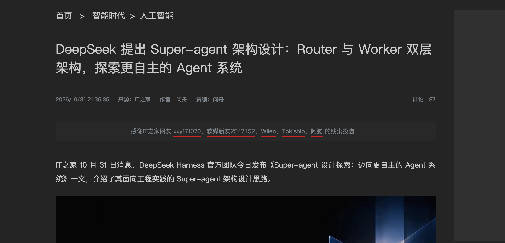
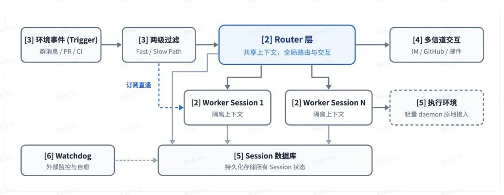
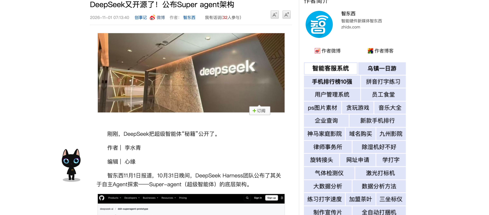

# DeepSeek 的 Super-agent 能 7×24 干活了，程序员的不可替代性还剩什么？

先说一件让我有点恍惚的事：我看到这个 Super-agent 原型的第一反应，不是「完了」，是去翻它发的 PR 有没有人合。

7×24、没人 @ 也主动认领、复现 Bug 修好才出声——这套话术每个字都在暗示「以后的仓库不需要人了」。可我过去一年基本靠 agent 写代码，经验就一条：**agent 越猛，我花在「看它干活」上的时间越多，不是越少。**<!-- 判断句 -->7×24 干活的是它，7×24 兜底的目前还是我。题主说生产力瓶颈是人的注意力，这话我认，但这恰恰是把问题问反了一半：瓶颈是人的注意力，意味着**接下来被定价的就是人的注意力**——谁的注意力值钱，谁的注意力白菜价，会分得清清楚楚。<!-- 判断句 -->

先给结论：程序员的不可替代性，剩下的部分是对结果负责的注意力。下面按题主点名的来：我是重度使用者，讲我这半年的真实变化，再给判据清单。

## 先把 7×24 拆回原文，水分不多，但有一个关键省略

DeepSeek Harness 团队 10 月 31 日发的[《Super-agent 设计探索》](https://www.ithome.com/1/020/615.htm)，我通读了一遍。原型已开源（GitHub 上的 dsh-superagent-prototype），官方明确说「用于验证技术路线，并非正式产品」。<!-- 判断句 -->

（图源：[IT之家](https://www.ithome.com/1/020/615.htm)，2026-10-31）

原文里真正重要的不是 7×24，是这句：团队观察**一个人通常只能同时跟进 3 至 5 个活跃 Session**。整套架构——Router/Worker 双层、事件驱动、投机执行、Watchdog——全部围绕这个限制做。<!-- 判断句 -->也就是说，连最会做 agent 的团队都承认：**现在的瓶颈不是模型不够聪明，是人盯不过来。**题主把这个判断放在问题描述里，是整道题最值钱的一句。<!-- 判断句 -->

（图源：DeepSeek Harness《Super-agent 设计探索》官方文章配图，[IT之家转引](https://www.ithome.com/1/020/615.htm)，2026-10-31）

## 注意力账本：升值和贬值的从来不是「程序员」，是三类具体动作

「程序员的不可替代性」是个太粗的问法。我这半年的体会是：拆开看，你的日常动作会分成两类账。

**正在贬值的三类动作：**

一是「把需求翻译成代码」。这个我上个月刚用一整篇展开过（[《AI 编程普及到底是替代程序员，还是把创造力平权给普通人？》](https://www.zhihu.com/question/2091803976455013001)），结论不变：翻译层的定价已经崩了。<!-- 判断句 -->

二是「在场」。7×24 听起来取代的就是这个——以前价值里有相当一部分是「出事了有人在线」，agent 常驻之后，「在线」本身不值钱了。

三是「手速」。Anthropic 10 月 16 日的报告里，人均 commit 数是半年前的 5 倍。commit 数正在快速通胀，拿产出速度当卖点，等于拿津巴布韦币结账。<!-- 判断句 -->

**正在升值的三类动作：**

一是**写清边界的能力**。给 agent 下指令时，把「空值怎么办、超上限怎么办、并发怎么办」显式写出来——写不出来的地方，就是需求本身有坑。Super-agent 原文里的两级过滤（先程序规则、再模型判断）本质上就是「边界前置」，只是它把这一步自动化了；人对 agent 的价值，同样在这一步。<!-- 判断句 -->

二是**快速验收的判断力**。agent 写的代码语法全对、跑起来大部分时候也对，错的那 5% 埋得很刁钻。Anthropic 报告里有个细节：AI 代码被 revert 的比例和手写代码没有可检测差异——平均水平已经不拖后腿了，分水岭在于你能不能亲手拦住那 5%。<!-- 判断句 -->

三是**兜底的领域深度**。这是我自己的实测：我们有次让 agent 跑一个带写入操作的批处理，它全程报 success、退出码 0——结果写库的操作一条都没成功，它把「命令执行了」当成了「事情办成了」。<!-- 判断句 -->这种错不在任何测试覆盖里，只有你真在这个系统里被烧过一次，才知道验收时该多看哪一行。agent 越自治，这类「沉默的失败」越多，兜底越贵。<!-- 判断句 -->

（图源：自制，依据 DeepSeek《Super-agent 设计探索》与 Anthropic 2026-10-16 就业报告）

## 一个反直觉的账：agent 越自治，人的注意力越贵

题主的设计第一原则是「占用最少的人类注意力」。听起来人的注意力在被省掉，我的体感正相反：**省的是「操作」，贵的是「判断」。**<!-- 判断句 -->

Super-agent 的设计里有个细节我很在意：Worker 不向用户汇报，统一由 Router 对外说话，只有「确认问题并找到简单修复方式后」才交付结果。翻译一下：**它主动替你决定什么是值得打扰你的事。**<!-- 判断句 -->7×24 的代价是，你不在场的每一分钟，都有东西在被自动判断。以前 agent 是你说一句它动一下，错也错在你看得见的地方；现在它自己会挑活干，错就错在你看不见的地方了。<!-- 判断句 -->

所以「还剩什么」我的答案收敛成一句：**剩的是对结果负责的注意力。**写代码、盯 CI、在线救火这些「过程注意力」在贬值；验收、划界、兜底这些「责任注意力」在升值。前者 agent 可以 7×24，后者目前没人能替你值班——包括 agent，因为出了事，客户和老板找的还不是它。<!-- 判断句 -->

（图源：[智东西，新浪财经专栏转载](https://finance.sina.com.cn/tech/csj/2026-11-01/doc-inixepty4335109.shtml)，2026-11-01）

## 收尾：一个能带走的自检清单

不用信我任何一句，拿这三个问题量自己：

一，你最近一个月的工作里，有没有一次是**你预判了 agent 会怎么搞砸、并提前拦下**的？拦下过，你在升值账上；一次都没有，小心你在贬值账上还不自知。

二，把你最得意的一段产出拿出来，**它能被自动打分吗？**能被 agent 自我验收的产出，定价权很快不在你手里。

三，如果明天给你一个常驻 agent，你敢让它**无人监督地动生产环境**吗？不敢的那部分，就是你目前还不可替代的部分——但注意，这是个会被慢慢啃掉的存量，不是铁饭碗。<!-- 判断句 -->

不可替代性从来不是一种身份，是一笔持续结算的账。7×24 的 agent 上线之后，这笔账的结算频率只会越来越高。

_2026-11-04 整理。事实来源：DeepSeek Harness 团队 2026-10-31《Super-agent 设计探索：迈向更自主的 Agent 系统》（IT之家转述，GitHub 仓库 deepseek-ai/dsh-superagent-prototype）；Anthropic 2026-10-16 就业报告（人均 commit 5 倍、AI 代码 revert 率无差异）；「写库失败仍报 success」出自本人团队实测经历。_
