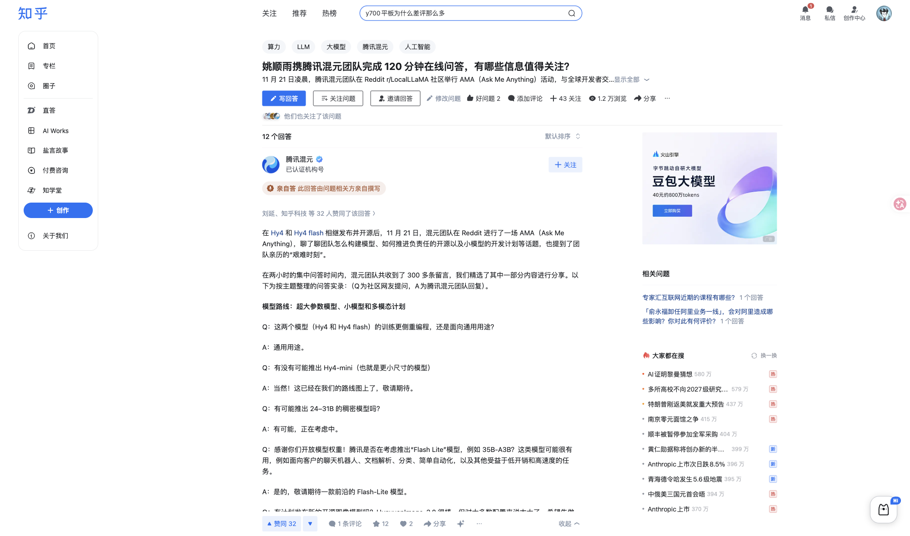
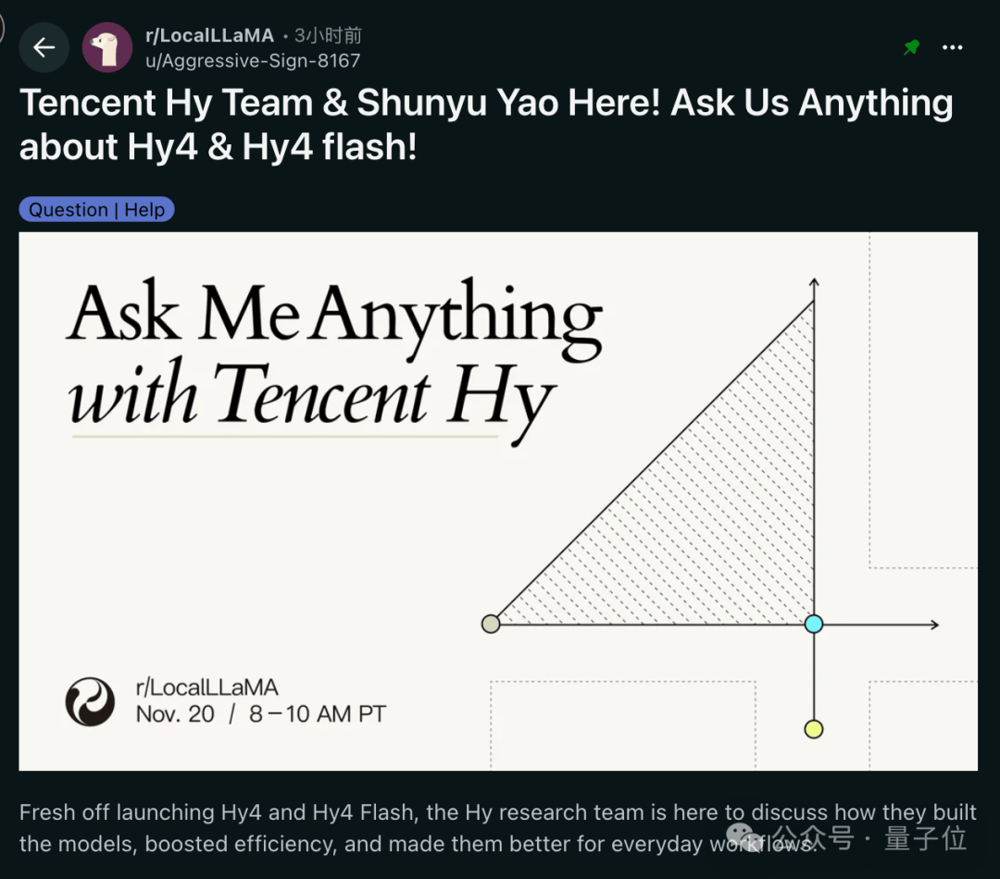
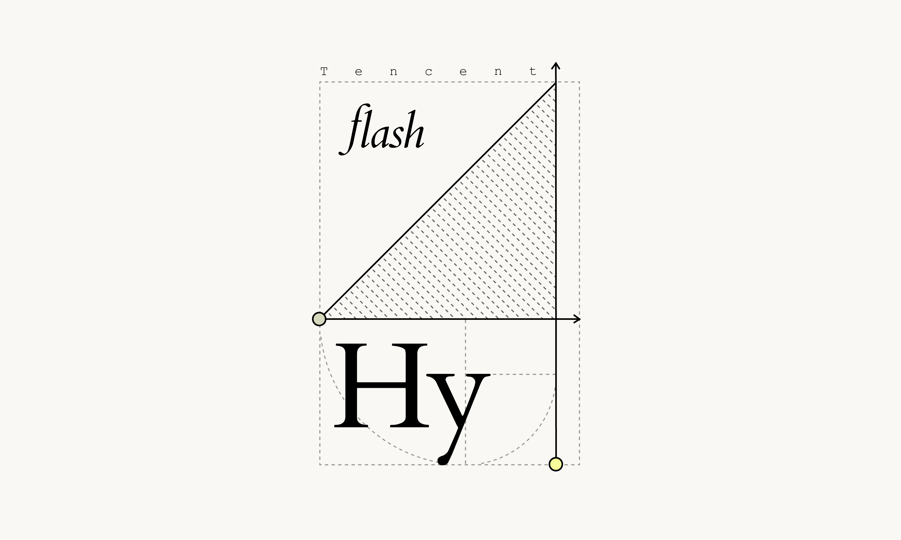
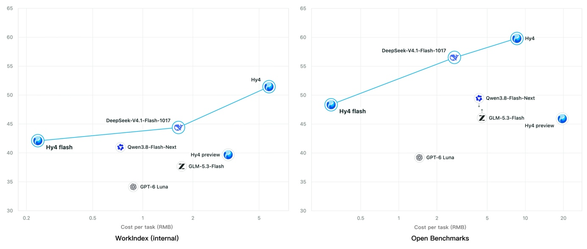

# 姚顺雨携腾讯混元团队完成 120 分钟在线问答，有哪些信息值得关注？

这场 AMA 最有信息量的不是那串「敬请期待」，而是三个被网友追问出来的表态。

11 月 21 日凌晨，腾讯混元团队在 Reddit 的 r/LocalLLaMA 社区做了一场 AMA（Ask Me Anything，网友随便问、团队现场答）。两小时，300 多条提问，官方随后把实录按主题整理发了出来。我通读完一遍，按值得关注的程度，一个一个说。

*图源：腾讯混元官方账号在知乎发布的 AMA 问答实录*

*图源：量子位对本次 AMA 的报道，Reddit 原帖截图*

## 一、参数量：嘴上说小模型够用，下一代还是要显著变大

AMA 里最尖锐的一个问题：字节、Kimi 都在往 3 万亿甚至 5 万亿参数推，你们为什么停在 7000 亿？

团队的回答是：Hy3 和 Hy4 已经表明，做得扎实的较小模型可以胜过更大的模型，成本更低，而且过程中能学到更多。听起来是不跟军备竞赛了。

但紧接着有人追问：到 Hy4.5 的时候，参数量会不会扩到 1.5 万亿到 2 万亿？回答是：下一代 Hy 模型的规模一定会进一步显著扩大，「我们相信 Scaling Law」（Scaling Law 是「模型越大越强」这条行业经验规律），并将继续投入。

两条放在一起看，表态其实是一句话：现在不堆参数是策略选择，不是路线放弃。<!-- 判断句 -->

这个时间点跟开放 Hy4 权重挨得很近，读起来像是同一个节奏：先把手头这一代做到开源最强，再谈下一代。<!-- 判断句 -->

## 二、小模型一口气给了四五个承诺，分量差很多

比参数量表态更具体的，是一连串小模型计划。但这些承诺的强度不一样，值得分级看：

1. 最实的：Hy4-mini，「已经在我们的路线图上了」。路线图是内部排期，这条最接近板上钉钉。
2. 其次：前沿 Flash-Lite（总参数 35B、激活 3B 这个量级，面向低成本高速度任务），「敬请期待」；新一代视频模型，「在路上」。
3. 最虚的：24B–31B 的稠密模型，「有可能，正在考虑中」；更小的开源图像模型，「会考虑」。

所谓稠密模型，是 MoE 的反面——MoE 每次只唤醒一部分参数，稠密模型每个参数每次都参与计算，小尺寸稠密模型对本地部署更友好，但训练同尺寸更难出效果。<!-- 判断句 -->

还有一句容易被忽略的：有人问多小的模型还能做有用的视觉理解（看懂截图、图表并推理，而不是只会描述「图里有只猫」），回答是激活参数 30 亿级别就可以。

这些承诺对普通用户意味着什么：本地跑的「小钢炮」模型一直是开源社区的短板，做旗舰的比做小的多得多。如果这几条兑现一半，明年用普通显卡跑「够用」的模型就是现实选项而不是发烧友行为。<!-- 判断句 -->

## 三、为什么不做「更稀疏」：激活参数就是计算预算

这是全场技术含量最高的一段问答，值得单独讲。

背景一句话：MoE 模型（混合专家模型）好比一个图书馆，总参数是藏书量，激活参数是每次真正拿出来翻的书。Hy4 flash 总参数 2240 亿，其中神经网络主干约 1560 亿、Engram 查表参数约 640 亿，每次激活 120 亿。

有网友问：别人能做到更低的激活比例（Qwen 的 Flash 是 4.8%，DeepSeek V4.1 低到 2.9%），你们为什么不把主干继续压成激活 8B 甚至 5B？

团队的回答是一个对称实验的两个方向：固定激活参数、把总参数做大做稀疏，这条路有效，是赚的；固定总参数、压缩激活参数，这条路预计明显伤质量，是亏的。

理由一句话——激活参数量本质上就是计算预算，减激活就是减算力，效率提升补不回来这个窟窿。还有一句更直白：过于稀疏的架构对推理不友好，占着大量显存却吃不满算力，同样吞吐下不如跑一个总参数相同但激活更多的模型。

*图源：腾讯混元官方 Hy4 flash 研究页*

这段问答的价值在于，它给「激活比例」这个各家发布会都在卷的数字一个反例：比例低不等于先进，可能只是在用显存换数字。<!-- 判断句 -->

## 四、两个罕见的自曝：最难的是「过度思考」，最慌的是升级前夜

AMA 惯例都有轻松问答，这次有两条意外诚实。

第一条，有人问后训练阶段最难改善的行为是什么。后训练是模型预训练练完之后的调教阶段，强化学习、对齐人类偏好都发生在这里。回答只有四个字：过度思考。展开说，Hy4 正式版有时会推理过长、绕不开弯，这是已知问题；而且恰好是这个「想太多」的 Hy4，才能蒸馏出性价比高的 Hy4 flash。蒸馏就是用大模型的输出教小模型，而「过度思考」留下的长推理过程，恰恰是做老师最值钱的原料——flash 再通过强化学习把思维链压短。<!-- 判断句 -->

第二条，研发过程中最困难的时刻是什么。回答是 Hy3 扩展到 Hy4 的时候：对数据做的消融实验（逐个去掉配方里的成分，验证哪个真有用）不够充分，开始训练时心里没底，「训练刚开始时，我相当紧张」。好在训练顺利得出乎意料，「感觉就像把筹码全押上，结果真的赢了」。

这两条放在一起，信息量在于：头部团队现在拼的已经不是架构创新，而是后训练的细节工程，而且连他们也没有把握每次押注都赢。<!-- 判断句 -->

另外顺带一提：网友拿出 AGI 分级图问 Hy4 在哪一级，回答是 2.5 级；至于递归自我改进（RSI，模型自己造下一代模型），明确说还在早期。

## 五、跟普通用户有关的两条承认

一是写作退化。有网友直言现在模型写作能力在退化、输出全是套路化表达，官方回答承认注意到了，认为可能跟训练目标有关，「我们希望模型写出来的内容更像人类，少一些套路化表达」。

这个归因说得比较客气。训练目标现在明显偏向可验证的任务（代码、数学、工具调用），写得好不好看没有标准答案，强化学习自然顾不过来——文风退化是这个导向的副产品，不是哪家故意摆烂。<!-- 判断句 -->

二是本地部署。有人问 96GB 显存加 128GB 内存能不能跑 Hy4 flash，回答是可以：权重和注意力放显卡，部分专家层和 Engram 查表参数挪到内存。更关键的是另一个回答：有人问把这些架构缩小成 30B–35B 的小模型，Engram 和 iHC 这些设计还能不能带来同样的提升（iHC 是 Hy4 里降低长上下文推理成本的连接设计），回答是「对较小模型带来的收益甚至更大」。

*图源：InfoQ 报道引用的官方 benchmark 性价比对比图*

## 哪些说了，哪些没说透

通篇看完，也有几件事是 AMA 没回答的：下一代模型的具体时间表没有，和 Qwen、DeepSeek 的直接对比没有（社区全程在拿 Qwen 3.8 Flash 比，官方只谈自己），算力受限到什么程度也没有量化。

这正常。AMA 这种形式，能确认的是路线意图，不能当路线图用。要我说，这次能确认的就三条：参数还要涨、小模型是真投入、「激活比例低」未必等于先进。<!-- 判断句 -->

_2026-11-21 整理。AMA 问答实录出自腾讯混元官方账号发布的主题整理（[原问题页](https://www.zhihu.com/question/2107402315917420498)）；Hy4 权重开放与模型安全评估卡片出自 11 月 20 日官方公告；Hy4 flash 参数（总参数 224B、每 Token 激活 12B、单任务成本约为 Hy4 的 1/20）出自官方发布口径。相关旧稿：[《腾讯姚顺雨谈「大模型公司护城河」》](https://www.zhihu.com/question/2103065564763482098)_
