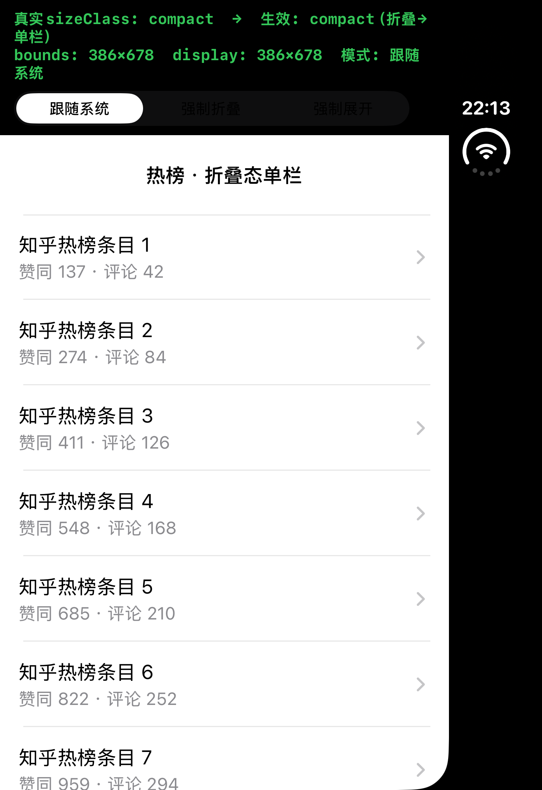
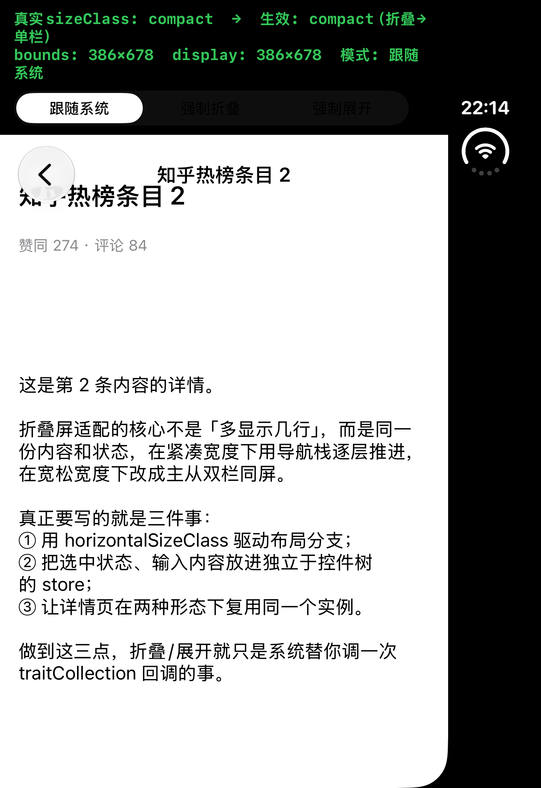
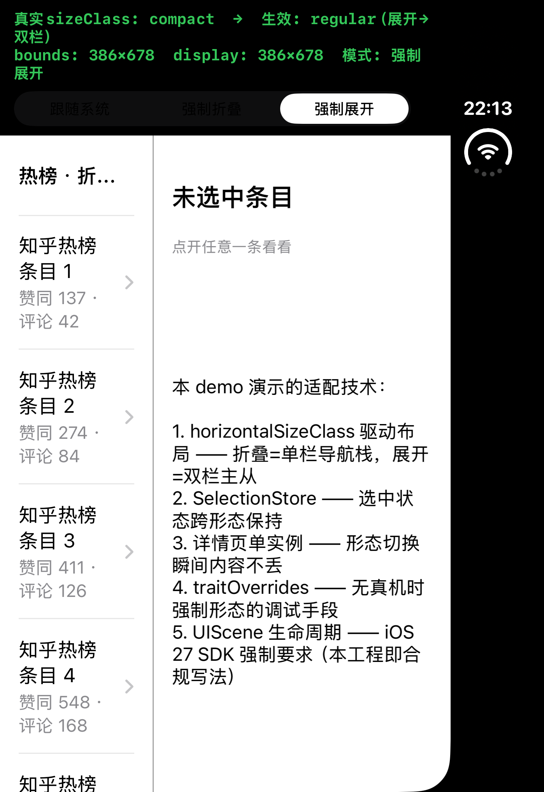
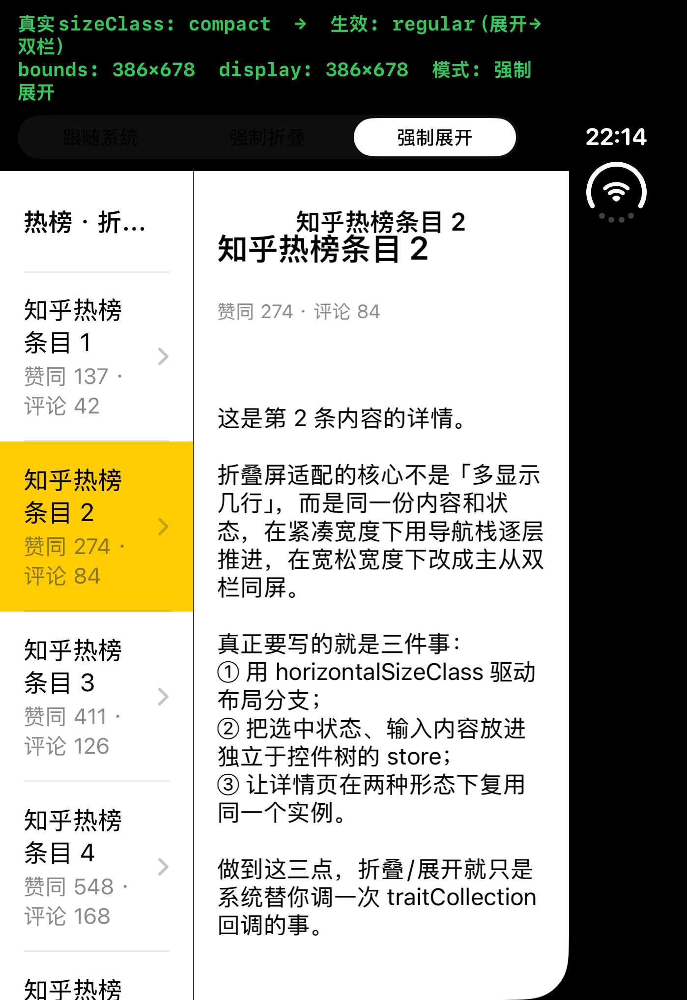

# iPhone Duo 适配折叠屏到底难在哪？iOS 原生和 Flutter 各有一张注意事项清单

先说结论：工作量和底层技术限制，两个都是真的，但两个都能拆成清单，一项一项做掉。这篇就把两张清单列出来——第一张给 iOS 原生开发，第二张给 Flutter 这类跨端开发。

先立一个共同的前提，它决定了所有人的时间表：苹果官方公告，2027 年 4 月起，上传到 App Store Connect 的构建必须用 iOS 27 SDK 构建，且最低兼容版本提到 iOS 15（[Apple Developer News，2026-09-09](https://developer.apple.com/news/?id=k1mtkt1k)）。更关键的是另一条官方规定：从 iOS 27 开始，用最新 SDK 构建的 App 必须采用基于 UIScene 的生命周期，否则无法启动（[Apple 官方迁移指南原文](https://developer.apple.com/documentation/uikit/transitioning-to-the-uikit-scene-based-life-cycle)）。

也就是说，不管原生还是 Flutter，2027 年 4 月之前都有一轮工程层面的硬改造要完成。下面两张清单，都从这个前提出发。（文中工具链版本与 API 现状截至 2026 年 10 月。）

## 第一张清单：iOS 原生适配的注意事项

**1. 老工程的第一件事不是改布局，是迁 UIScene。**

iOS 13 引入的 UIScene 架构，在 iOS 27 上从"建议"变成了"强制"。用 Xcode 27 的 SDK 构建、但还停在旧式 AppDelegate 生命周期上的 App，在 iOS 27 系统上直接无法启动。Xcode 27 的新工程模板已经全部改成 SceneDelegate 架构，老工程需要按官方迁移指南补 `UIApplicationSceneManifest` 声明和 SceneDelegate，这一步排在所有布局工作之前。

**2. 布局判断的锚点从"横竖屏"换成 size class。**

苹果在官方 Tech Talk《[Prepare your app for iPhone Duo](https://developer.apple.com/videos/play/tech-talks/111461/)》里明确建议：用 size class 替代 interface orientation 做布局判断。落到 Duo 上很简单——折上，外屏 5.4 英寸（1398×2034），横向尺寸是 compact；展开，内屏 7.6 英寸（2670×1878，约 1:√2 的比例），横向尺寸是 regular。<!-- 判断句 -->判断"用户现在处于哪种形态"，不要自己算分辨率，永远读 `traitCollection.horizontalSizeClass`。

我自己写的一个最小示例里，全部布局判断就这一行：

```swift
if traitCollection.horizontalSizeClass == .regular {
    // 展开态：双栏主从
} else {
    // 折叠态：单栏导航栈
}
```

**3. 双栏主从结构用系统语义写，一行代码两种形态。**

折叠态和展开态不是两个页面，是同一份内容的两种排法。`showDetailViewController` 这个 API 的语义就是：compact 下等于 push，regular 下等于更新右栏。用它做主从切换，代码里不需要出现任何"如果当前是折叠屏"的判断。也可以用 UISplitViewController，双栏、单列的自动变形它包了。

折叠态下的效果（单栏列表，点进去 push 详情）：





**4. 状态必须放在控件树外面。**

形态切换的瞬间，单栏变双栏，原来的导航栈会被拆掉重排。如果选中状态、输入到一半的文本、滚动位置存在某个视图控制器实例上，切换后就丢了。正确做法是放进一个独立于视图层级的 store，布局代码只认 store。这条做不到，前面三条做得再漂亮，展开瞬间用户正在看的内容也会没掉。

**5. safe area 是不对称的，别假设上下相等。**

同一个官方 Tech Talk 里专门点了这一条：Duo 的内屏 safe area 上下左右并不对称。所有边距交给 `safeAreaInsets`，不要写死 padding。

**6. 双屏切换不是一次 resize，是一次换屏。**

这是折叠屏和"大字号 iPhone"最本质的区别。折上到展开，App 不是从窄窗口拉成宽窗口，而是从外屏整个迁到内屏——屏幕对象换了，分辨率从 1398×2034 跳到 2670×1878。布局刷新要挂在 trait 变化的回调上（`traitCollectionDidChange`，或 iOS 17 之后的 trait change 注册 API），只依赖 `viewDidLayoutSubviews` 会在换屏场景漏事件。

**7. 测试基建自己先备好，别指望命令行。**

Duo 模拟器是 Xcode 27.1 才提供的设备类型（27.0 没有），而且它是双屏模型：外屏和内屏是两块独立的模拟器屏幕。两个实践结论：一是命令行切屏不可靠，折叠切换的入口在 DeviceHub 应用里；二是没有真机时，可以用 `traitOverrides` 强制形态做布局调试——把 `horizontalSizeClass` 强制成 regular，双栏代码对不对立刻能验证。下图就是我用强制展开跑出来的双栏效果，顶部的 HUD 如实标注了"真实 compact、强制 regular"：



真展开态长这样——左栏列表带选中高亮，右栏同步显示详情，选中状态两边共享：



（以上四张均为 demo 自截图，不是媒体图。）

## 第二张清单：Flutter 等非原生方案的注意事项

**1. 构建门槛三件套，先补齐再谈折叠。**

Flutter 3.47（2026-08-12 发布）的官方 release notes 写明"为 Xcode 27 做准备"：最低支持版本从 iOS 13 提到 iOS 15，且 iOS 27 SDK 构建的 App 必须已迁移 UIScene，否则无法启动（[Flutter 3.47 release notes](https://docs.flutter.dev/release/release-notes/release-notes-3.47.0)）。对应动作：Flutter SDK 升到 3.47+；iOS 工程 deployment target 提到 15.0；3.47 的新工程模板已经内建 UIScene 架构（Info.plist 里有完整的 `UIApplicationSceneManifest`），老工程跟着官方迁移说明走一遍。

**2. 分清"能构建"和"有折叠感知"——这是两件事。**

<!-- 判断句 -->3.47 解决的是"能不能交出合规的包"，不是"知不知道自己跑在折叠屏上"。Flutter 的 DisplayFeature API（`MediaQuery.displayFeatures`，就是 Android 折叠屏上用来读铰链角度和折痕位置的那套）在官方文档里明确写着仅在 Android 上填充；iOS 上 Flutter 应用对折叠形态零感知，官方仓库已有专门的 issue 在跟进（[flutter/flutter#192515](https://github.com/flutter/flutter/issues/192515)）。pub.dev 上也已经有第三方包在尝试补这个缺口，但都属于社区方案。

知道这一条，"等不等官方 SDK"才是一个有信息量的决策，而不是一句牢骚。

**3. 三条路线，按团队情况选。**

| 路线 | 做法 | 成本 | 风险 |
|------|------|------|------|
| 等官方 | 什么都不做，等 DisplayFeature 支持 iOS | 零 | 时间不可控，死线前可能等不到 |
| 纯 Dart 凑活 | 按宽高比和屏幕尺寸粗判形态（内屏约 1:√2 很好认），自己切双栏布局 | 低 | 拿不到系统级形态切换回调，换屏瞬间只能靠尺寸变化猜，不可靠 |
| 自写 Platform Channel 插件 | iOS 侧写原生代码读形态、订阅切换事件，经 MethodChannel/EventChannel 暴露给 Dart | 中 | 要自己维护，跟版本 |

**4. 选自写插件的话，注意点有五个。**

一是 iOS 侧读什么：直接读 `UIWindowScene` 的 `traitCollection.horizontalSizeClass`，这是系统钦定的形态判定值，不要自己算像素。

二是 channel 怎么分工：MethodChannel 做"查询当前形态"，EventChannel 做"订阅形态切换"，查询和订阅分开，App 启动先查一次、再挂上订阅，两条路都走到。

三是协议要版本化：channel 命名带上你的域（比如 `com.yourapp/duo_state`），传参用 map 并保留冗余字段，给后续加"铰链角度"这类新信息留位置——苹果后续开放更多折叠参数时，插件不用 breaking change。

四是注意 scene 生命周期：iOS 27 上窗口和场景是分离的，场景重建后 EventChannel 的监听要在新的 scene 上下文里恢复，订阅代码别写死在一个全局位置。

五是留好 fallback：读不到形态信息时（老 iOS 设备、非折叠机型），按普通 iPhone 的单栏布局渲染，插件返回 unknown 而不是猜一个值。<!-- 判断句 -->核心代码其实只有几十行，这个插件的真正成本不在写，在跟——跟随 Xcode、iOS 和 Flutter 的版本节奏做回归。

写法上直接照官方文档来：[Writing custom platform-specific code](https://docs.flutter.dev/platform-integration/platform-channels)。

**5. 一条红线：别碰私有 API。**

折叠形态检测只走 UIKit 公开接口（traitCollection、UIScene），私有 API 不仅审核有风险，系统一升级就是定时炸弹。

## 最后：时间表怎么排

- 现在 → 2027 年 4 月前：Flutter 侧先把三件套补齐（升 3.47、target 15、UIScene 迁移），这一步不做，到期连包都传不上去；
- 折叠体验：原生按第一张清单的 2-6 做，优先级最高的是 size class 布局和状态保持；
- Flutter 侧折叠感知：急着上线就自写插件，不急就先用纯 Dart 粗判顶住，同时盯 issue #192515 等官方收编。

一句话收个尾：**原生适配的难点不在写布局，在迁移和测试基建；跨端的难点不在构建合规，在拿不到系统感知**——前者是 2027 年 4 月的死线，后者可以先用几十行的插件补上，等官方 SDK 来收编。

---

## 主要信源

- Apple Developer News：2027 年 4 月起构建要求（https://developer.apple.com/news/?id=k1mtkt1k ）
- Apple《Transitioning to the UIKit scene-based life cycle》（https://developer.apple.com/documentation/uikit/transitioning-to-the-uikit-scene-based-life-cycle ）
- Apple Tech Talk《Prepare your app for iPhone Duo》（https://developer.apple.com/videos/play/tech-talks/111461/ ）与《Strike a pose with adaptive layouts on iPhone Duo》（https://developer.apple.com/videos/play/tech-talks/111463/ ）
- iPhone Duo 规格（苹果官网 https://www.apple.com.cn/iphone-duo/ ）
- Flutter 3.47 release notes（https://docs.flutter.dev/release/release-notes/release-notes-3.47.0 ）
- Flutter issue #192515：iOS 上填充 DisplayFeature 的提案（https://github.com/flutter/flutter/issues/192515 ）
- Flutter Platform Channel 官方文档（https://docs.flutter.dev/platform-integration/platform-channels ）
