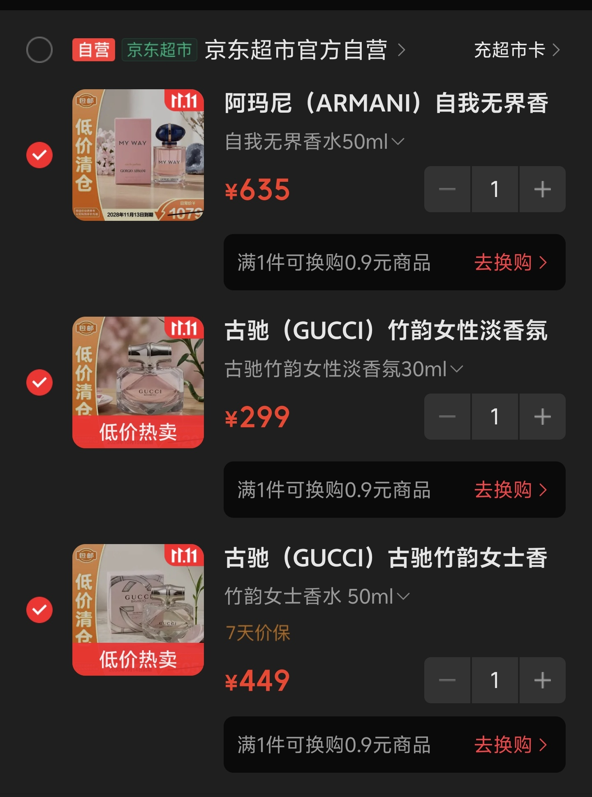
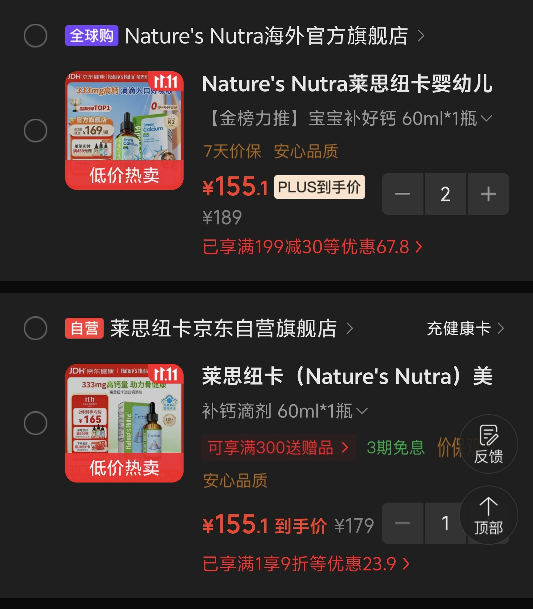
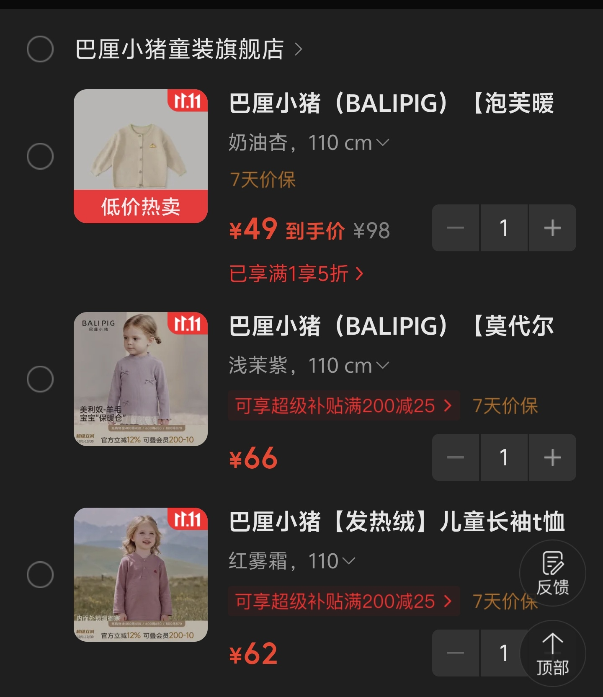

双十一翻购物车，我翻到一个有点不好意思的事实。

这一整车东西，没有一件是我自己的。

三件香水，是老婆的。阿玛尼 MY WAY 50ml，京东超市清仓价 635；古驰竹韵 30ml，299；同款 50ml，449。三件都打着勾，合计 1383。

<!-- 判断句 -->我最犹豫的就是这 1383。不是买不起，是三瓶一起结算这件事本身，有点像双十一的氛围组在替我老婆做决定。她平时一瓶香水能用一年多，三瓶下去是三年的量。<!-- 判断句 -->大概率要砍掉一瓶，砍哪瓶才是问题——MY WAY 是清仓价，过了这村可能没这店；竹韵两瓶留着一瓶，留大的还是留小的，差价 150，容量差 20ml，怎么算都是 50ml 划算，可 30ml 那瓶才是她提过喜欢的那支。

男人的算盘在这里是失灵的。我能算清每毫升多少钱，算不清她喷哪瓶的时候心情好。

往下是娃的钙滴剂，莱思纽卡，60ml 一瓶，总共放了 3 瓶。这个反而没什么犹豫，家里早就定好要补，我放进购物车只是为了比价。

比价的结果也挺有意思。同一个东西，海外官方旗舰店和京东自营，到手价一模一样，都是 155.1。但划线原价一家写 189，一家写 179，满减的玩法也不一样，一家是满 199 减 30，一家是单件 9 折。<!-- 判断句 -->换句话说，这两家店是在用不同的算术公式，算出同一个答案给你看。你看到「同价」会以为行情透明了，其实恰好说明这个价就是它们商量好的心理锚点。

<!-- 判断句 -->我的结论是：同价就选自营，发货快，售后省事。犹豫的点不在买不买，在要不要为了满 199 减 30 再多凑一瓶——凑完单价是低了，总支出多了 155，这个账很多人双十一都算反了。

再往下是娃的秋装，巴厘小猪，一件外套 49，两件打底 66 和 62。加起来 177，还没有一瓶香水贵。这类反而是购物车里最不用犹豫的东西，刚需，换季，便宜，点击结算就行。

所以绕了一圈，我自己呢？

我也翻了。翻了挺久，想看看有没有一件我能顺手带上的，耳机、键盘、手柄，都想过。最后一件没加。<!-- 判断句 -->不是觉悟高，是想到的那些东西，手里都有能用的。旧的没坏，新的就下不去手——这可能就是有家有娃之后购物车的常态，默认排序从「我想要」变成了「他们需要」。

<!-- 判断句 -->真要说今年双十一我卡在哪，就卡在香水那三瓶上。三选二，等老婆拍板。其他都痛快。

哦对，差点忘了说，香水和衣服都挂着 7 天价保。<!-- 判断句 -->所以我也不打算硬等 11 月 11 日当天，真降价了申请价保退差就行，这是平台自己给的后悔药，不用白不用。

你们的购物车里，有没有一件东西也是留给别人拍板的？

#2026双十一 #知乎犹豫商店
