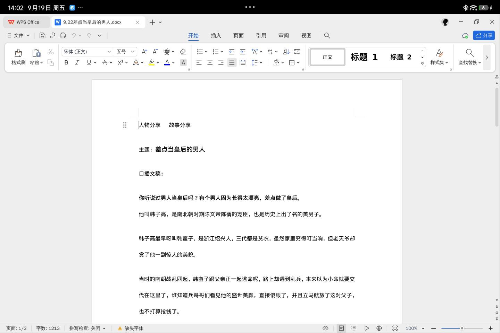

有。而且你的预算在这个尺寸段属于「花不完」的那档——12 到 13 英寸、4000 元以内，最值得看的就三台：约 1100 元起的小新 Pad Pro 12.7、1899 元起的荣耀平板 X10 Pro Max、近期到手约 3200、三台里性能最强的荣耀 MagicPad 3 12.5。

先把丑话说在前面，再一台台过。

## 你说的这四件事，12-13 寸干起来是什么体验

**刷视频：这个尺寸就是为这件事生的。**<!-- 判断句 -->屏幕大一寸体验好一截，这跟参数无关，是物理决定的；12.7 寸的板子支在床头或者桌架上，跟在电视和手机之间又多了一个档位。这个尺寸段普遍配了四扬声器，外放也不是手机能比的。你四件事里，这一件最没有悬念。

网课和学习这件事，选对屏幕类型比选品牌更重要。<!-- 判断句 -->这个价位能买到一种叫「柔光屏」（雾面屏）的东西，表面做了防眩光处理，台灯下、窗边上网课看讲义，反光少一截，长时间盯字的眼睛负担小一些。但有一条得说清：柔光屏解决的是舒服，不是防近视，没有任何认证支持它能减缓度数加深，厂商自己的产品页也只标到防眩光，没标防近视。<!-- 判断句 -->

（图源：IT之家，华为 MatePad 柔光版图赏）

办公能干轻活，但姿势要对。<!-- 判断句 -->小米、华为、联想的平板上都能跑 PC 级 WPS，改文档、填表、做 PPT 没问题，配个蓝牙键盘能顶替电脑出场一阵子。但 12-13 寸的板子普遍 600 克上下，端在手里办公十分钟就明白它正确的位置是桌面支架。真要在平板上一周码五天字，那是笔记本电脑的活，不是加钱上平板能解决的。<!-- 判断句 -->

（图源：IT之家，小米平板 8 运行 PC 级 WPS）

打游戏这块如实说，是 12-13 寸最明显的短板。<!-- 判断句 -->600 克出头的金属板子双手横握，手腕十来分钟就酸；不少手游对大尺寸平板的适配也不上心，两边留黑边或者裁掉一截视野，拇指还够不到中间的键位。两个解法：主流安卓平板都支持蓝牙手柄，王者原神这类接上手柄放桌上玩，重量问题就没了；或者干脆云游戏，算力在云端，板子只出屏幕。

（图源：小白测评。小尺寸平板双手横握的样子，12-13 寸横握比这重近一倍）

要是打游戏的占比大到超过另外三件事的总和，那其实有个专门物种叫游戏小平板，8.8 英寸的拯救者 Y700 那种，跟你要的尺寸是两条路，这里不展开。

## 三台怎么选

价格都是京东自营近一个月的成交口径，国补 15%、单件封顶 500 元，叠加券之后波动很大，下单前以当日页面为准。

| 型号                     | 屏幕                 | 芯片（一句大白话）                            | 重量/电池            | 到手价参考                       |
| ------------------------ | -------------------- | --------------------------------------------- | -------------------- | -------------------------------- |
| 小新 Pad Pro 12.7 2025款 | 12.7 英寸 2.9K 144Hz | 天玑8300，中端偏上，官方数据原神能跑 59 帧，按厂商口径打个八折算        | 600克出头 / 10200mAh | 约 1079 起（活动价 1269 叠国补） |
| 荣耀平板 X10 Pro Max     | 13 英寸 2.5K 120Hz   | 骁龙6s Gen2，入门级，网课视频流畅、游戏别指望 | 618g / 10100mAh      | 1899 起                          |
| 荣耀 MagicPad 3 12.5     | 12.5 英寸 3K 165Hz   | 骁龙8 Gen3，旗舰芯片，三台里性能最强  | 528g / 10100mAh      | 发布价 2699 起，近期到手约 3200  |

**先看小新 Pad Pro 12.7，2025 款天玑 8300 那版。**<!-- 判断句 -->你四件事里它三件半干得很好：视频、网课、办公都稳，游戏接上手柄也不虚——官方给的数据是原神须弥城极高画质 20 分钟平均 59.1 帧（[IT之家评测](https://www.ithome.com/0/784/617.htm)，数字源头是联想发布前的实验室预热），厂商口径按八折算，到手稳 50 帧上下没问题，对这个价位算很能打。近期京东自营 8+128 活动价 1269 元，叠国补实付低至 1079 元（[什么值得买 2026-10-17 爆料](https://www.smzdm.com/p/184166840/)）。<!-- 判断句 -->四扬声器、10200mAh 电池、支持 1TB 存储卡扩展，莱茵无频闪低蓝光认证也全。

（图源：IT之家，联想小新官方微博）

（图源：IT之家，联想小新官方微博）

不适合谁：想要裸机电竞手游体验的——600 克出头的板子双手横握，手腕十来分钟就酸，不少手游对这个尺寸的适配也不上心，这两个坎绕不过去；也不适合认准华为生态协同的人——它跟华为手机的联动约等于没有。另外认准 2025 款天玑 8300 版，老款骁龙 870 的别买。<!-- 判断句 -->

预算想多花一点、要性能余量的，看荣耀 MagicPad 3 12.5。<!-- 判断句 -->骁龙8 Gen3 强过天玑8300 一档，12.5 英寸 165Hz 屏配八扬声器，528g 也是三台里最轻的（在 12-13 寸里算控制得好）。它的价值在于四件事都更从容、用三五年不卡，不是当游戏机。2025 年 10 月发布，发布价 2699 元起（[快科技发布报道](https://news.mydrivers.com/1/1080/1080317.htm)），近期京东自营 8+256 页面价 3499、领券实付约 3199（什么值得买 2026-10-14 爆料），实际到手比发布价高出一截，下单前以商品页为准。<!-- 判断句 -->

不适合谁：预算卡两千内的——它贵出来的那一千多，买的主要是芯片，你四件事里另外三件事感知不强；指望拿它当游戏机的也一样，它是性能余量，不是游戏机。<!-- 判断句 -->

纯影音网课、一点游戏都不碰的，选荣耀平板 X10 Pro Max。<!-- 判断句 -->13 英寸是清单里最大的屏，1899 元起（[IT之家 2026-08-28 开售报道](https://www.ithome.com/0/995/513.htm)），IMAX Enhanced 和 DTS 双认证，2TB 存储卡扩展，存课存剧的人不用纠结容量。<!-- 判断句 -->

不适合谁：任何人想拿它打游戏的都别买，骁龙6s Gen2 是入门芯片，这个钱全花在屏幕和电池上了。<!-- 判断句 -->

## 那 iPad 呢

4000 预算在 12-13 寸这个尺寸段，苹果基本出局。<!-- 判断句 -->iPad Air M4 的 13 英寸版京东近期约 4700+，已经超了你「出一点预算」的范围；iPad 标准版（A16，11 英寸）倒是 2999 上下，但那是 11 寸、60Hz 屏，跟你点名的尺寸对不上，同价位硬件也被上面三台围得很紧。除非你全家桶在苹果生态里，不然这道题先不用看它。

## 下单前一件事

不管选哪台，去店里或者借一台真机，双手握十分钟。<!-- 判断句 -->12-13 寸适不适合自己，手比参数表诚实。下单顺手勾运费险，收货七天里重度用：打几局游戏、躺床上刷半小时视频、开一节网课，不对劲就退。

你这个需求，大概率一千出头的小新 Pad Pro 12.7 就全办了，剩下三千预算不是必需品。<!-- 判断句 -->

想按人群和价位把 26 款在售平板对一遍号的，我把完整清单整理在这里：[2026 年平板推荐：我把 7 个品牌 26 款在售平板翻完，发现带货文不会说的 5 件事](https://zhuanlan.zhihu.com/p/2083683190741509750)

（价格与促销信息截至 2026 年 10 月，国补 15% 封顶 500 元、双 11 叠加券后价格波动大，下单前以商品页为准。）

<!-- 判断句清单（交付汇报用，发布前删除）：
1. 开头「最值得看的就三台」——盘点结论
2. 「刷视频：这个尺寸就是为这件事生的」
3. 「网课学习选对屏幕类型比选品牌重要」+「柔光屏解决舒服不是防近视，厂商产品页只标防眩光没标防近视」（事实描述口径）
4. 「办公能干轻活，姿势要对」+「一周码五天字是笔记本电脑的活，加钱上平板解决不了」
5. 「打游戏是12-13寸最明显的短板」+手柄/云游戏解法
6. 「游戏占比超过另外三件事的总和→Y700 是另一条路」
7. 「小新三件半干得很好，游戏接手柄不虚（官方 59.1 帧系厂商实验室口径，按八折算）」+价格口径
8. 「小新不适合裸机电竞/华为协同用户，认准天玑8300版」
9. 「MagicPad3 定位是性能余量与流畅寿命，不是游戏机；近期到手约3200，比发布价高出一截」（价格口径已按数据校验家修正：发布价2699/京东8+256领券约3199）
10. 「X10 Pro Max 纯影音网课，别拿它打游戏」
11. 「苹果在这个尺寸段基本出局」
12. 「一千出头小新就全办了，剩下三千预算不是必需品」
2026-10-22 v2 修订记录：吸收批评家+数据校验家两轮审读，改 10 处（四台→三台、MagicPad 价格口径、图位、破句式对称 3 处、存课存剧改自然表述、厂商句改事实描述、唯一→最明显、开头拆句、iPad 标准版注明 A16）；已仲裁立场与骨架未动。
2026-10-22 v2.1 作者仲裁：MagicPad 3 摘掉「游戏机」定位（那是另一个预算的故事），游戏段直说「正经打游戏是笔记本电脑干的事」；开头、游戏段、MagicPad 段、判断句清单同步修订。办公段「另一个预算的故事」同期改为直说笔记本电脑。
2026-10-22 v2.2 作者仲裁：游戏段保留「正经打游戏是笔记本电脑干的事」，删「清库存」攻击句（与 Y700 论据冲突）。
2026-10-22 v2.3 作者手删游戏段「正经打游戏是笔记本电脑干的事」整句，同步清理三处悬空引用：小新不适合谁改为自包含表述（重量+适配直接说）、MagicPad 段删「前面说过了」、MagicPad 不适合谁「顶替游戏本」改为「当游戏机」。
2026-10-22 v2.5 作者仲裁：芯片表述不漏底，删「隔了三代」，直说「骁龙8 Gen3 强过天玑8300 一档」。
2026-10-22 v2.6 事实修正：「原神接近满帧」系联想实验室预热口径被 IT之家评测转引，非独立复测（百度百科口径约 55.9 帧）；改为「官方数据 59.1 帧，按厂商口径八折算，到手稳 50 帧上下」。
-->

<!-- 图片溯源映射（发布前删除本段）
平板选购指南2026/千元平板/rouguang_vs_glossy_compare.jpeg -> https://s41.ax1x.com/2026/10/23/pnBz3wt.jpg
平板选购指南2026/到底要不要买平板/y700-bx-back-hold.png -> https://i.imgs.ovh/2026/10/20/6af1967779e11c5cd3a53493e549aed7.png
平板选购指南2026/到底要不要买平板/小新PadPro12.7-外观1.jpg -> https://i.imgs.ovh/2026/10/20/6db7d877017e85daa185c99db50702c7.jpg
平板选购指南2026/到底要不要买平板/小新PadPro12.7-外观2.jpg -> https://s41.ax1x.com/2026/10/23/pnBz8TP.jpg
（四张均为既有图床图复用：两张 IT之家小新官方图与一张小白测评 Y700 图原用于 到底要不要买平板，一张柔光对比图原用于 千元平板，重核与本文段落相关；v2 已将双色背面图挪回小新段落内）
（2026-10-23 修复：柔光对比图与小新外观2图原图床链接已死（404/超时），按本地原图 --force 重传为上方 10-23 新链接，内容经回看校验一致；外观2 alt 由「双色背面」改为与实际画面一致的「官方海报：轻薄全金属机身」）
重传命令：node .agents/skills/image-host-upload/upload.js --force "平板选购指南2026/有什么好用的平板/zhihu-有什么好用的平板-v2.md"
-->
