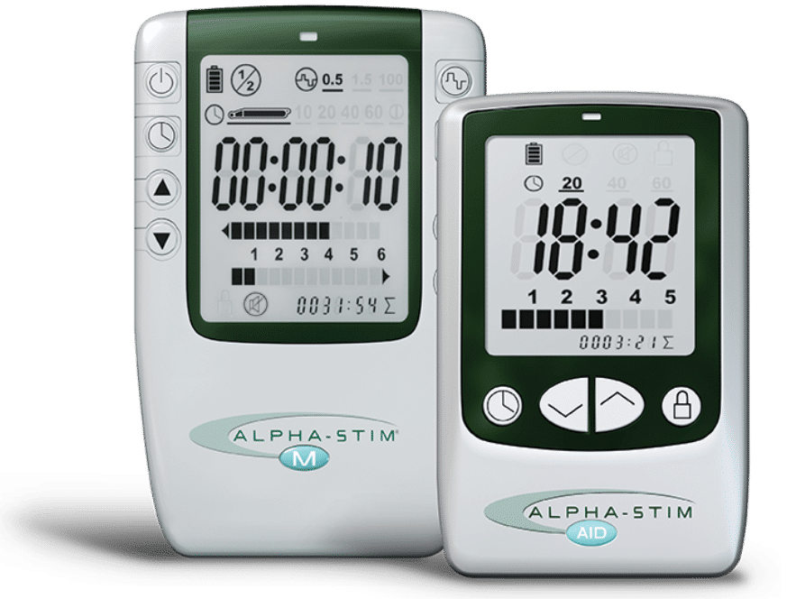
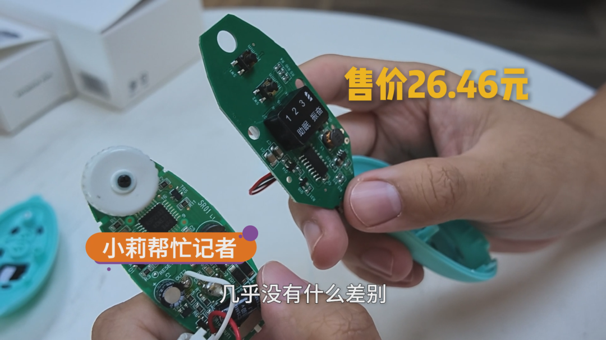
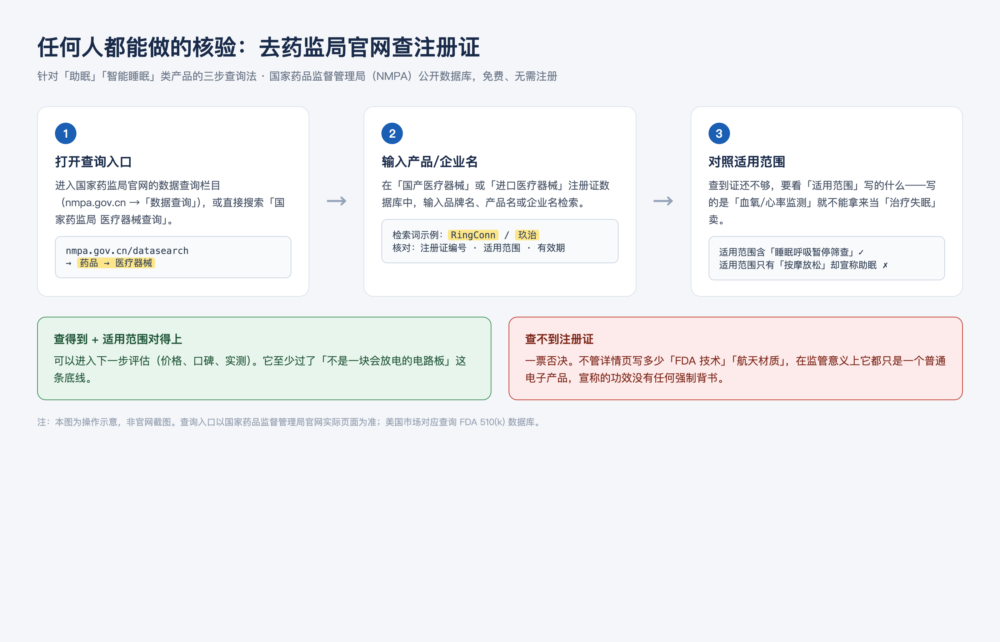
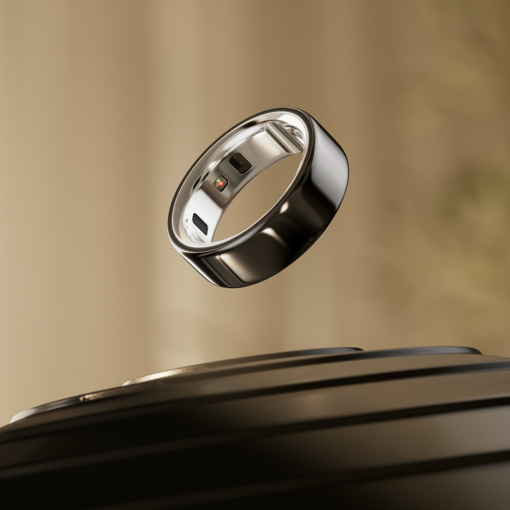
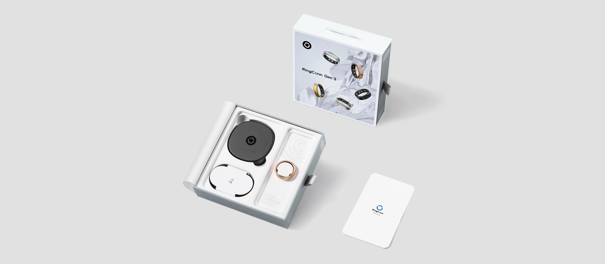
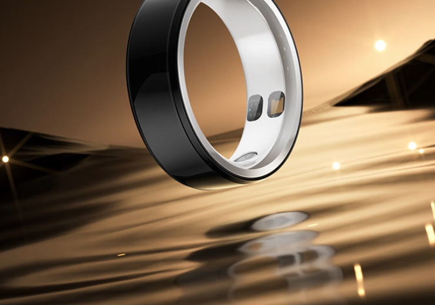
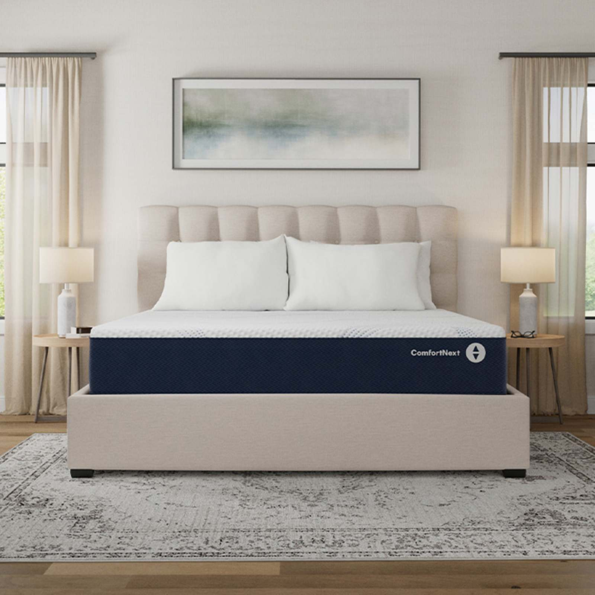
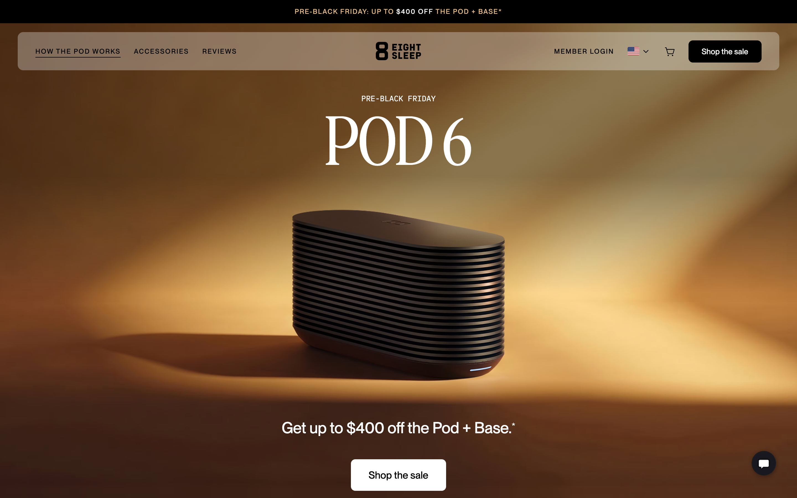
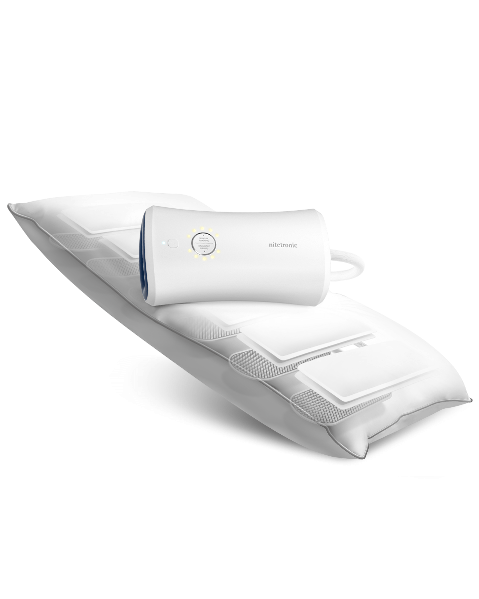
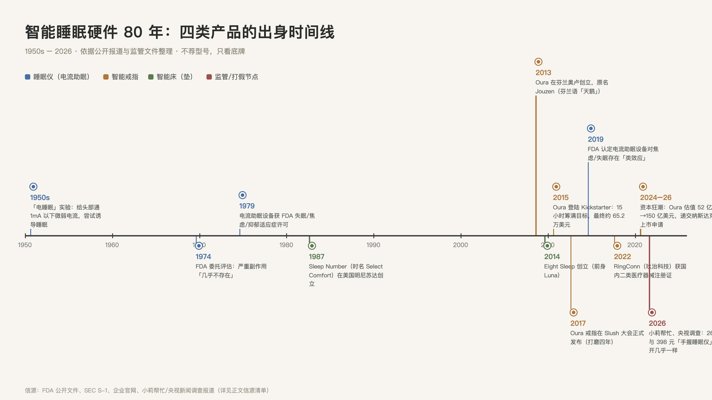

# 四类智能睡眠硬件，从起源讲起：80 年里，人类为了睡个好觉都往头上戴过什么

先说一个画面。

1950 年代，苏联和欧美的实验室里，研究者在做一件今天听起来有点科幻的事：给失眠的人头部通上微弱电流，看能不能让他们「电睡过去」。电流小到 1 毫安以下——大概是普通充电器输出电流的几十分之一，夹在耳朵上或者贴在太阳穴上，人几乎没什么感觉。

80 年后，2026 年 9 月，河南广播电视台的民生栏目「小莉帮忙」做了另一件事：记者网购了 4 款热销的「手握睡眠仪」，价格从 26 元到 398 元不等。拆开一看，398 元那款号称「美国原装进口」，和 20 多块钱的内部结构几乎一样。

两件事隔了 80 年，说的是同一个愿望：让我睡个好觉。中间隔着的，就是这整个智能睡眠硬件行业。

这篇文章不种草、不推荐型号，只干一件事：把市面上四类最常见的「智能睡眠」硬件——睡眠仪、智能戒指、智能床（垫）、智能睡眠枕——的家底翻一遍。它们从哪来、凭什么火、哪些有真东西。四个品类，四种出身，四种底牌。

看完你会发现一个反直觉的规律，先剧透：最古老的技术和最新的形态，反而最靠谱。夹在中间那些顶着「智能」二字的拼凑品，才是智商税重灾区。

## 一、睡眠仪：最古老的品类，一部「电流助眠」的执念史

四个品类里，睡眠仪是唯一一个「先有的医学，后有的商品」的。它不是厂商拍脑袋发明的，是医学研究实在做了几十年，然后才有人拿去做成商品卖。

故事得从头讲。上世纪五六十年代，「电睡眠」实验就开始了：头部通微弱电流，观察能不能诱导睡眠。做这个的科学家们自己也不确定有没有用，所以 1974 年，美国国家研究委员会受 FDA 委托，专门做了一次安全性评估，结论是：这种强度的电流用在头部，严重副作用「几乎不存在」。

连安全性都要先论证一遍，这就是这个品类出身的特殊性——它一开始就是按医学的路子走的。

真正商品化的节点在 1980 年代。按最老牌的家用电流助眠设备厂商 Alpha-Stim 官方文件引用的文献，这类设备 1979 年就获得了 FDA 对失眠、焦虑、抑郁适应症的许可。到 2019 年，FDA 正式把这类设备重新分类，认定它们对焦虑和失眠存在「类效应」——翻成人话：这个效果是整个品类共有的，背后有一整摞共同证据撑着，不是某一家厂商自说自话。

下面这张图就是 Alpha-Stim 的两代家用设备：一台主机加耳夹电极，没有屏幕花活，长得就像一件医疗器械——因为它确实按医疗器械的路子走了半个世纪。

不过学界的态度始终更克制。2021 年一篇系统性综述（把几十项研究汇总评估的论文）的结论是：电流刺激对失眠、焦虑、抑郁的伴随症状缓解有研究支持，但证据质量参差，还需要更严格的试验。

注意这里的措辞——「缓解症状」，不是「治疗失眠」。

这个措辞之差，是后面所有是非的根源。

因为听起来差不多，很多厂商就踩着这个模糊地带进来了。2026 年 9 月「小莉帮忙」拆的那 4 款手握睡眠仪就是典型：上手都只有微弱电流刺激，多个商家拿不出有效的功效检测报告，产品外包装标注的执行标准早已废止，甚至有厂家工作人员对着镜头直言「有点交智商税」。9 月底央视新闻也跟进曝光了同类乱象。

这类东西本质上更接近廉价的电击按摩仪——就是理疗店里贴在皮肤上那种，松肌肉用的，和正经冲着睡眠去的电流助眠不是一回事。打个比方：一个是给你捶背的，一个是给你治失眠的，外壳做得再像，里面也是两码事。

所以判断睡眠仪的底线只有一条，而且任何人都能操作：打开国家药品监督管理局官网的医疗器械查询页，输入品牌名，看有没有注册证。

有证的，背后站着半个世纪文献；没证的，就是一块会放电的电路板。

价格上也别贪便宜：有证的家用设备普遍在数百到数千元，几十块钱的东西连注册的成本都覆盖不了。

## 二、智能戒指：最年轻的品类，从诺基亚的废墟里长出来的上市公司

睡眠仪的故事是「医学降维成商品」，戒指的故事就是标准硅谷剧本：巨头废墟上，三个工程师赌一个没人看好的形态。

2013 年，三位出身诺基亚和 Polar（芬兰心率设备厂商）的工程师在芬兰奥卢创立了 Oura。公司最初叫 Jouzen，芬兰语「天鹅」的意思，2017 年才改名 Oura Health。第一代产品在众筹平台 Kickstarter 上发起众筹：目标 10 万美元，15 小时就筹满了，最终筹到约 65.2 万美元。

但别被众筹的顺利骗了——从创立到正式发布，这枚戒指打磨了整整四年，直到 2017 年的欧洲科技大会 Slush 才亮相。

前七年，Oura 过得并不风光，一度工资都要拖欠几个月。转折有两个：一是疫情把「日常健康监测」变成大众需求，戒指成了扎克伯格、谷爱凌、C 罗的标配；二是 2022 年职业经理人 Tom Hale 接任 CEO，商业化开始狂奔。

后面的估值曲线比产品本身还陡：2024 年 12 月融资 2 亿美元（血糖仪巨头德康领投），估值 52 亿美元；2026 年 9 月正式向纳斯达克递交上市申请，拟募资最高 22 亿美元，估值约 150 亿美元。

招股书里有组数字值得玩味，我用大白话拆给你看：截至 2026 年 6 月的 12 个月里卖出约 360 万枚戒指，营收 12.1 亿美元、同比增长 74%。账面显示净亏 9.24 亿美元——但先别被吓到，这个亏损主要是会计处理造成的：公司上市前回购了投资人手里的优先股，按规则这笔支出要一次性记成「分给股东的股息」，看起来像巨亏，其实钱不是这么烧掉的。看真章的指标是：同期净利润为正 6080 万美元，经营现金流为正 3.28 亿美元。会算账的读者可以自行判断这门生意到底烧不烧钱。

**戒指为什么特别适合测睡眠？**

这是个真问题。现在手环、戒指测心率用的都是光电法——往皮肤里打光，看血液流过时光线反射的变化。而手指的动脉血流信号比手腕好测得多：血管密集、活动少，信号质量天然占优。何况戒指只有 2–4 克，续航普遍 7–14 天。

更实际的理由是体验：夜里手腕戴表硌得慌的人，手表数据会大片断档；一枚 4 克的戒指戴着没感觉，数据才连得上。数据这个东西，连续比精准更值钱。

国内这边，出海品牌 RingConn（深圳玖治科技）是绕不开的名字。据投中网、36氪报道，它早在 2022 年就拿下了国内二类医疗器械注册证——医疗器械分三类，三类最严（心脏支架那种），二类居中，需要临床验证；其睡眠呼吸暂停筛查功能宣称准确率达 90.7%（注意，这是企业宣称值，不是独立第三方验证）；2026 年 10 月又获得 FDA 的 510(k) 许可，用于无创血氧测量。510(k) 是 FDA 的一种审批通道，意思是「我和已上市的同类产品实质等同」，比全新审批快，但也是正经过审。

「无订阅、全功能」是 RingConn 对着 Oura 打的最直接的一张牌，而且打得很准：Oura 硬件约 300 美元起，但完整功能要开订阅，每月约 6 美元，三年下来订阅费本身就要两百多美元，持有成本快赶上半个硬件。国内常见的智能戒指价格带在 900–3000 元，下单前先问一句：功能是全给的，还是硬件收了钱、数据还要按月买？

这个赛道当然也有反面教材，而且教材价值极高。

追觅 2025 年 10 月发布的前代「震动 AI 智能戒指」登上央视春晚，官方宣称累计订单破亿；2026 年 3 月的二代 Glow（首发价 1499 元）延续了这波热度，官方宣布 4 月单月全渠道营收突破 1100 万元。但 36 氪旗下「电厂」随后报道，三位戒指业务内部人士质疑实际销售额「应该在百万级别」——离官宣数字差了一个数量级，且该产品没有医疗认证。

同一件事，官宣口径、媒体口径、内部口径能差这么多。所以读这类新闻请区分三个词：**宣称销量、订单金额、实际营收**。订单下了可以退，金额可以含水分，只有营收是实打实进账的钱。

## 三、智能床（垫）：把传感器铺在你整夜躺着的地方

先给结论，再讲为什么：智能床是四类里唯一全线没有医疗认证的品类，购买决策的信任只能靠一样东西兜底——免费试睡。

这个品类的老大哥是 Sleep Number：1987 年创立于美国明尼苏达，最早卖可调软硬的气囊床垫，后来把传感器和自动调节塞进床垫，现在是上市公司。

真正把「智能床」讲成性感生意的是新贵 Eight Sleep：2014 年创立于纽约（前身叫 Luna），2015 年 1 月在众筹平台 IndieGogo 筹到超 100 万美元——注意它卖的不是床垫，是「智能床垫罩」，铺在你现有床垫上的「传感+加热层」。后来进化成 Pod 系列：用水循环制冷/加热，温控范围约 13–43°C，按你的体温曲线自动调节。2026 年 3 月，它拿到 Tether 领投的 5000 万美元战略轮，估值 15 亿美元。

技术上先分清一个维度：传感器怎么放。接触式做进床垫或床罩里，直接贴身，数据质量尚可；非接触式垫在床下或用雷达隔空探测，不影响你换床品，但精度打折。

在此之上还有一个更关键的分野：只「监测」，还是敢「干预」。干预式会主动调温、调硬度，这是卖点所在，也是智商税高发区——「干预有效」这四个字，举证责任全在厂商，不能只看广告。

为什么敢这么说？因为「监测得准」和「干预有效」是两件事。体温和深睡眠的关联有扎实的睡眠医学文献，所以「调温助眠」原理上站得住；但消费级产品大多只证明了「监测相对可信」这一半。我在公开注册信息里没查到任何一款拿到医疗级睡眠监测认证的智能床——这个品类在监管意义上属于「健康消费品」，不是「医疗器械」。国内价格带大致从几千元到两三万元。

国内市场更要泼点冷水：传统床垫厂商给产品线加上传感器和 App 就冠名「智能」，是这两年的常规操作。而智能床的耐久性——电机、气囊、传感器天天用、年年衰减——在投诉平台上能见度不低。大件、带电、每天使用，先天就是耐用品里最难的那一档。

所以在没有医疗认证背书的情况下，敢不敢给你 30 天以上免费试睡，就是厂商的底牌。敢给的，至少对退货率心里有数；不敢给的，参数写得再漂亮也别信。当然，敢给也要配合退货细则看：是不是全额退、运费谁出。

## 四、智能睡眠枕：最尴尬的品类，手环技术的下放产品

智能枕是四类里没有独立起源故事的品类。

它没有「某公司发明智能枕」这样的高光时刻，有的是手环和戒指的监测模块成熟之后，厂商自然想到的一个方向：把传感器塞进枕头。所以市面上的智能枕，本质上是一块记忆棉/乳胶/气囊，加一套和 200 元手环同源的监测方案。

它能做的是翻身、心率、鼾声记录——说白了，它给你一份你本来就不需要的报告。价格倒不贵，几百到一千多元，但这个钱买到的「智能」，是四类里最薄的。

至于「干预」，气囊调高度止鼾这类产品确实存在，但证据薄弱。我查过公开注册信息，没查到获得医疗器械注册的止鼾智能枕——这个「没有」，你也可以自己复核。

所以这一类的真话是：如果你的预算是「改善睡眠」，优先级排序应该是——先遮光、先解决枕头本身的软硬度合不合适、先规律作息。监测这件事，戒指和手环的数据质量比枕头方案高一个档次。智能枕不是不能买，而是它解决不了它宣称要解决的那个问题。

## 结尾：一张 80 年的时间线，和一个判断标准

把时间线拉直了看：

1950s 电睡眠实验 → 1974 FDA 委托安全性评估 → 1979 电流助眠设备获 FDA 许可 → 1987 Sleep Number 创立 → 2013 Oura 创立 → 2014 Eight Sleep 创立 → 2015 Oura 众筹成功 → 2017 Oura 正式发布 → 2022 RingConn 获国内二类医疗器械证 → 2024–2026 资本狂潮（Oura 估值 52 亿→150 亿美元）→ 2026「小莉帮忙」、央视调查手持「助眠仪」。

看出规律了吗：活得长、活得好的，手里都有同一张底牌——要么是半个世纪积累的临床文献（电流助眠），要么是医疗级认证（RingConn、Oura 的医疗线合作）。而 2026 年被打假的那些，共同点也只有一个：除了「智能」「助眠」两个词，什么都拿不出来。

所以判断一件睡眠硬件值不值，不用懂技术，先问一句：**它敢去药监局注册吗？**

四个问题，任何一类都适用：

1. 药监局官网查得到注册证吗？（查不到的一票否决）
2. 它做的是「监测」还是「干预」？宣称干预的，看它引的是注册证编号，还是「某研究报告」这种没法核验的说法。
3. 新闻里说的是「订单金额」还是「实际营收」？
4. （主要适用于床和床垫）敢不敢让你白睡 30 天？

最后说回开头那个画面。80 年前往头上通电流的科学家，和今天往头上戴戒指的我们，都是同一个人——晚上睡不着的人。

区别只在于，那个年代的人至少知道自己在参与一项实验；而今天货架上很多产品，只想让你以为科学站在它那一边。

---

## 事实核查与信源清单（发布前删除本节）

（与 v3 稿一致，三审数据校验家已逐条核验 ✅：Oura 2013 创立/2015 Kickstarter $651,803/2017 Slush 发布/2024-12 估值 $5.2B/2026-09 公开 S-1 拟募最高 $2.2B；净亏 $924M 系优先股回购视同股息，净利润 +$60.8M、经营现金流 +$328M【SEC S-1、财联社、Fierce Healthcare】；RingConn 2022 NMPA 二类证据投中网/36氪、OSA 90.7% 企业宣称、2026-10 FDA 510(k)【人民政协网】；追觅前代戒指 2025-10 春晚+订单破亿、Glow 2026-03 首发 1499、官宣 4 月营收 1100 万 vs 电厂内部人士称百万级【36氪、中新网上海、电厂】；CES 1974 NRC 评估、1979 FDA 许可、2019-12-20 FDA class effect（84 FR 70003）、2021 综述措辞「缓解症状」；打假=小莉帮忙 2026-09-19+都市快报+央视新闻 9 月底，不写「央视财经」；Eight Sleep 2014 前身 Luna、IndieGogo 超 $1M、温控 13–43°C、2026-03 Tether $50M 战略轮估值 $1.5B【TechCrunch】；Sleep Number 1987 明尼阿波利斯创立）

发布前待办：

- [ ] Oura 订阅价「每月约 6 美元」：常见报道 $5.99/月，复核
- [ ] 四个品类价格带：定性区间，发布前用电商实际在售价格抽查
- [ ] 「无医疗级睡眠监测认证的智能床」「无获证止鼾智能枕」：NMPA 官网复核一次
- [ ] 智能床耐久性投诉：定性表述，如需加强检索黑猫投诉

## 图源清单

- 图A：Alpha-Stim 官网 alpha-stim.com 官方产品图（家用微电流设备）
- 图B：河南广播电视台「小莉帮忙」2026-09 报道视频截图（记者手持拆解后电路板，售价 26.46 元）
- 图C：Oura 官网 ouraring.com Oura Ring 4 官方产品图
- 图D：RingConn 官网 ringconn.com RingConn Gen 3 官方开箱图
- 图E：追觅 Dreame Ring 官方发布物料（经 IT之家 2025-10 报道转载）
- 图F：Sleep Number 官网 sleepnumber.com ComfortNext 系列官方产品图
- 图G：Nitetronic 官网 nitetronic.com Z6 智能止鼾枕官方产品图
- 图1（时间线）：自制，HTML 渲染，数据见正文信源清单
- 图2（注册证查询三步法）：自制操作示意，非官网截图
- 图4：Eight Sleep 官网 eightsleep.com 产品页截图（官方产品图）
- 无本人登录态页面截图，无电商商品页截图，无促销海报

（原「图源占位」小节已由以上正式图源替换）
