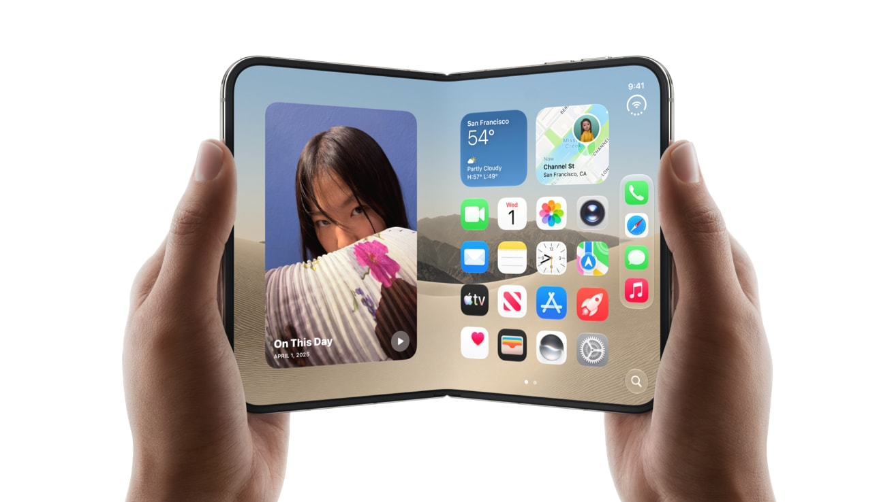
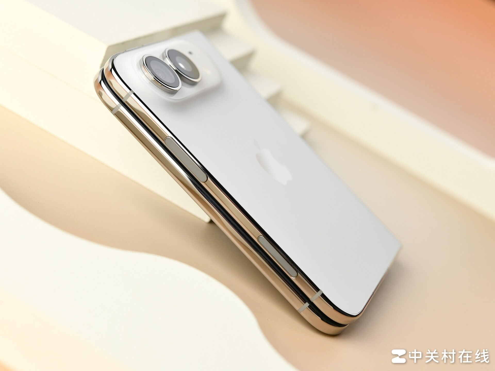
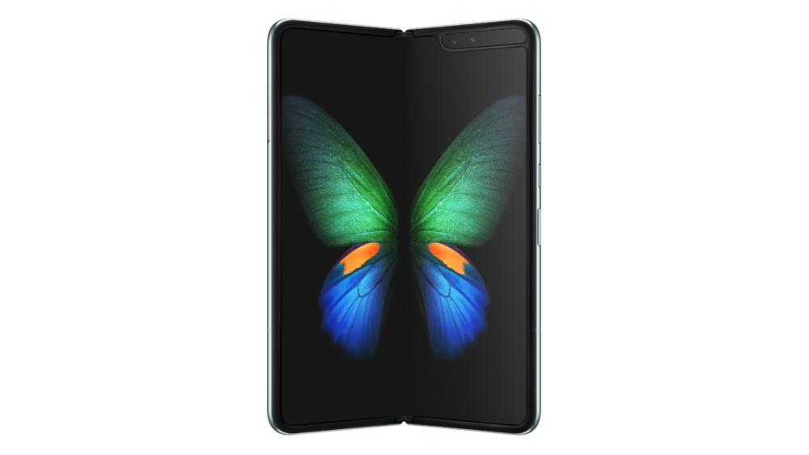
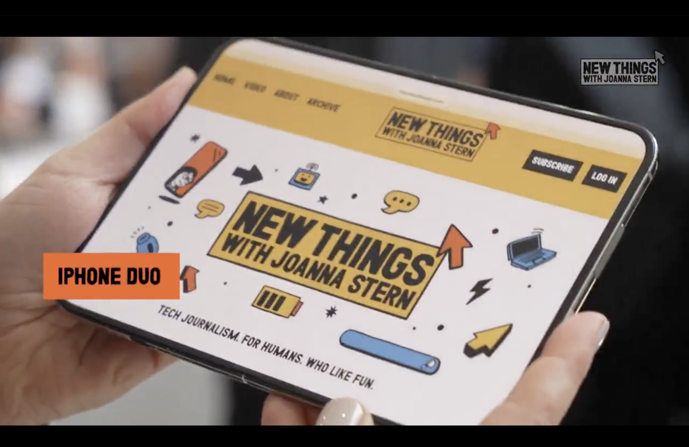

网上还能翻到那段视频。一位数码博主在评折叠屏，大意是手机折叠干什么呢，一折叠售价翻倍，性能还不行，适配也跟不上。他还立了个 flag，苹果不可能出折叠屏，真出了只能说明这家公司不行了，得靠折叠搞噱头。

现在 iPhone Duo 挂在官网上，15999 元起，2TB 卖 26499。回旋镖飞了几年，正中脑门。

热闹归热闹，这件事真正值得聊的不是他打没打脸。是一个更硬的问题，如果连一个靠嘴吃饭的博主都觉得不该折叠，苹果养着几千号工程师，为什么还要做。

<!-- 判断句 -->

## 先把「该不该折叠」翻译成一道物理题

折叠能换来的东西只有一样，一块更大的屏。付出的东西是一长串，厚度、重量、电池容量、铰链寿命、屏幕耐折性、维修成本，还有软件适配。

这道题的答案就写在参数表上。Duo 折叠起来 11.3 毫米，254 克。三星今年 7 月发的 Galaxy Z Fold8，9.7 毫米，201 克。Duo 比它厚 1.6 毫米，重 53 克。

*图源：Apple Newsroom*

53 克是什么概念。iPhone 18 Pro Max 是 249 克。你多花一万块买的那台折叠屏，比你能买到的最重的直板 iPhone 还重 5 克。

把厚度拆开算一遍更有意思。Duo 展开是 5.2 毫米，折叠是 11.3 毫米，两个 5.2 加起来 10.4，剩下 0.9 毫米是合拢之后两半之间的缝。三星那边，展开 4.5，折叠 9.7，两个 4.5 加起来 9.0，缝是 0.7 毫米。

*图源：中关村在线*

Duo 厚出来的这 1.6 毫米里，有 1.4 毫米来自每一半机身都比人家厚，只有 0.2 毫米是缝。它的铰链缝隙确实压得更紧，但机身主体把这点优势全吃掉了，还倒欠一截。

<!-- 判断句 -->

参数表比发布会诚实。

## 2019 年那笔账，确实算不过来

户子那代人的直觉不是凭空来的。他们不是不懂折叠能换大屏，是觉得这笔买卖不划算。用一台砖头的重量和厚度，换一块能折起来的屏，屏中间还压着一道印子。

2019 年的时候，这笔账确实算不过来。

那一年三星初代 Galaxy Fold 给美国媒体发评测机，4 月 15 日发出，几天之内多台机器在折叠处隆起、闪屏、黑屏，彭博那位记者的机器两天就报废了。4 月 22 日三星宣布推迟原定 4 月 26 日的发售，最后拖到 9 月 6 日才在韩国开卖。延期四个半月。

*图源：Samsung Newsroom*

一个开完发布会的产品回炉重造。这件事给全行业的信号很清楚，折叠屏的可靠性当时是未知数。谁在那个时间点押上去，押的是自己的品牌信誉。

所以苹果那几年的沉默，不能简单理解成没想到。风险项太大，账算不过来。

## 变的是账本，不是物理

到 2026 年，折痕还在。

*图源：New Things / Joanna Stern，经 IT之家 转载*

白底网页下那道印子看得很清楚。行业到今天也没有统一的折痕等级标准，DXOMARK 的屏幕测试体系里根本没有折痕分项，厂商手里拿的是莱茵 TÜV 这类自己委托、自己送测的认证。有实验室测过，新机折痕峰谷差 48 微米，折过三千次变成 167 微米，深度会涨，只是涨得慢。

铰链寿命也是一个道理。三星给 Z Fold8 标的是 50 万次额定。苹果从来没公布过 Duo 能折多少次，网上传的 20 万、30 万，翻遍官网找不到出处。

物理代价一分没少。那账为什么能算了。

三件事变了。

供应链熟了。铰链、UTG 玻璃、OLED 面板，今天都有成熟供应商，不用自己从零啃。

可靠性从未知变成已知。折痕不好看，但它不会让你三天内黑屏。华尔街日报那位记者用自制机器折了三万两千多次，铰链反而变紧了点，日常用没感觉。这跟 2019 年发出去的评测机两天报废，已经是两个世界。

需求侧也变了。愿意花一万五买一台能装进兜里的平板的人，比 2019 年多得多。大屏的使用场景被短视频、移动办公、手游推着长了出来。

**这里变的是分母，不是分子。**折叠的物理代价没变，是这个社会对代价的容忍度变了。

<!-- 判断句 -->

## 库克是不是外行

回到提问里那句话，库克是个外行。

这句话放在产品审美上，成立。库克是运营出身，供应链、库存、渠道是他的看家本事，定义产品不是。苹果这些年被骂挤牙膏，骂的就是这个。

放在商业决策上，不成立。Duo 的定价和配置组合，恰恰是运营思维的标准答案。它不需要是最好的折叠屏，它需要的是把一万五这个价位段占住。

三星做折叠，是要在形态上抢一个身位，抢到就是新品类的话语权。苹果不需要抢。它的用户每年都在问同一个问题，苹果有没有折叠屏。这个问题问得越久，公关成本越高。

<!-- 判断句 -->

所以它敢交一台更厚、更重、更贵的折叠屏。晚三星七年入场，比人家厚 1.6 毫米，重 53 克，起售价还高一截。

这台机器更像苹果，而不是更好。

<!-- 判断句 -->

户子那句话，有一半是对的。

不对的那一半，是他把技术不成熟当成了方向错误。技术会成熟，方向不会因为不成熟就消失。拿 2019 年的良率去否定一个十年的方向，这是把当下的困难读成了终局。

对的那一半，是他直觉摸到了苹果的变化。一家公司如果还在定义品类，它不需要跟着别人的形态走。等它开始填补品类空缺，说明它从出题的人变成了答题的人。

这两个身份没有高下，赚钱方式完全不同。出题的人拿定价权，答题的人拿市场份额。

## 他想了十年，只是没解决

据彭博社报道，苹果的折叠项目大约 2016 年就启动了，媒体普遍的说法是十年磨一剑。

十年之后交出来的答卷是 11.3 毫米、254 克、一道看得见的折痕。

他当然想到了。想到了，也没解决。

<!-- 判断句 -->

折叠屏到今天仍然是一道没解完的物理题。所有做折叠的厂商都在同一道题上作答，苹果只是答得晚、答得贵、答得更像它自己。

至于该不该折叠，这个问题本身问偏了。它不该问手机该不该折，该问你拿它当手机还是当平板。

当手机用，它是你今年能买到的最差的一台手机。重、厚、贵，还怕摔。当平板用，它是目前最好的那台能塞进裤兜的平板。

户子问的是前一种用法，库克答的是后一种用法。两个人从头到尾没在同一个问题上，所以谁也说服不了谁。

给你一个能落地的判断。翻一下手机上周的屏幕使用时间，看看有几小时是真的需要一块 7.6 寸的屏，比如看表格、改文档、剪视频、玩横屏游戏。

这个数字不到两小时，折叠屏对你就只是一台更重的手机，多花的一万块买的是展开那一下的新鲜感。

超过四小时，说明你一直在用一台折叠屏该干的活，硬塞在一块 6.9 寸的屏里。这种人买折叠屏，是真的省事。
