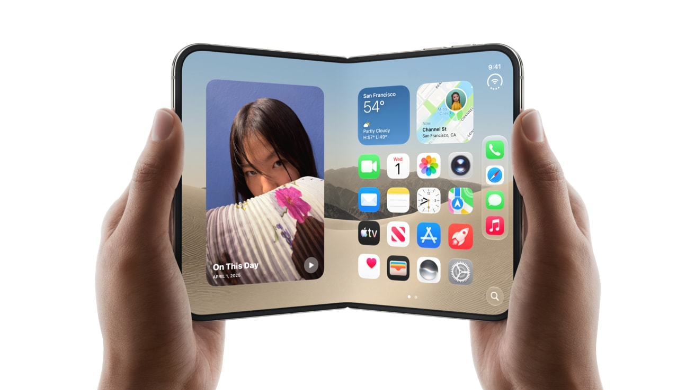
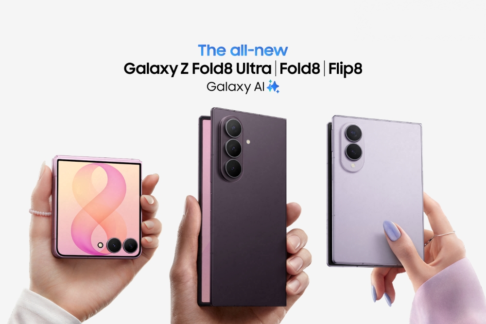
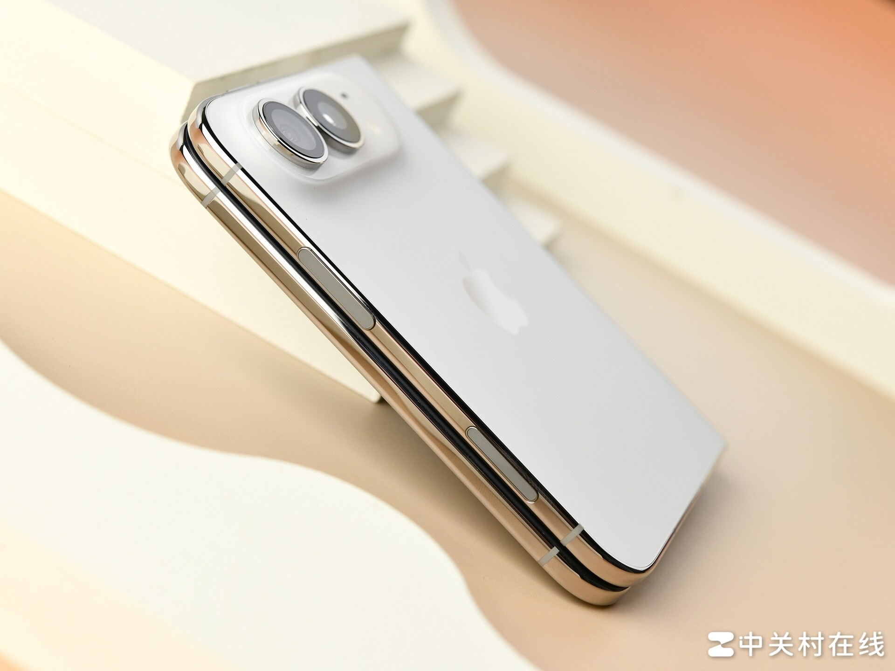
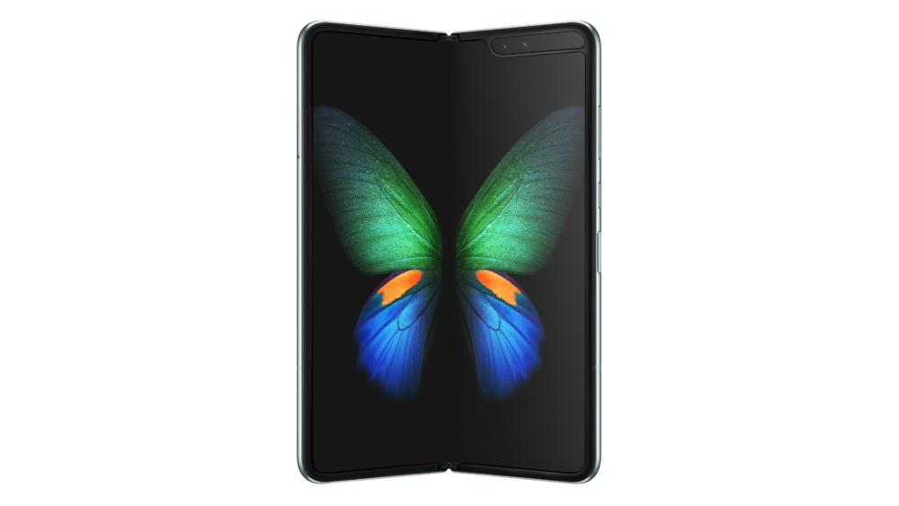
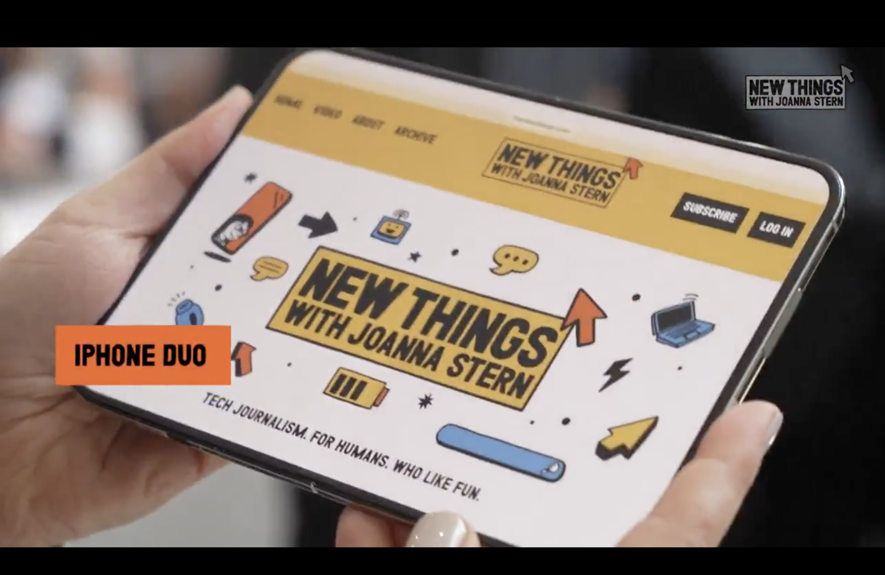

网上还能翻到那段视频。一位数码博主在评折叠屏，大意是手机折叠干什么呢，一折叠售价翻倍，性能还不行，适配也跟不上。他还立了个 flag，苹果不可能出折叠屏，真出了只能说明这家公司不行了，得靠折叠搞噱头。

现在 iPhone Duo 挂在官网上，15999 元起，2TB 卖 26499。

这梗已经被玩了两天，笑点很足。但如果只把它当笑话看，会漏掉一个更硬的问题。连一个靠嘴吃饭的博主都觉得不该折叠，苹果养着一支成规模的工程师团队，为什么还是要做。

<!-- 判断句 -->

## 先把该不该折叠算成一道物理题

折叠能换来的东西只有一样，一块更大的屏。付出的东西是一长串，厚度、重量、电池容量、铰链寿命、屏幕耐折性、维修成本，还有软件适配。

这道题的答案，其实写在参数表上。

Duo 折叠起来 11.3 毫米，254 克。三星今年 7 月发布、8 月开售的 Galaxy Z Fold8，9.7 毫米，201 克。Duo 比它厚 1.6 毫米，重 53 克，起售价还贵 3000 元。

*图源：Apple Newsroom*

53 克是什么概念。iPhone 18 Pro Max 是 249 克。你多花几千块买的那台折叠屏，比 iPhone 18 Pro Max 还重 5 克。

*图源：Samsung Newsroom*

再把厚度算一遍，能看出更多东西。Duo 展开 5.2 毫米，折叠 11.3 毫米，两个 5.2 加起来 10.4，剩下 0.9 毫米大致对应合拢后两半之间的缝。三星那边，展开 4.5，折叠 9.7，两个 4.5 加起来 9.0，缝是 0.7 毫米。

*图源：中关村在线*

Duo 厚出来的 1.6 毫米里，两半机身各厚 0.7 毫米，合计 1.4 毫米，剩下的 0.2 来自那道缝。缝隙这一项它也更大，0.9 对 0.7。

也就是说，那种苹果把中轴两端做平了的说法，经不起算。它的铰链缝隙比对手宽，机身每一半也比对手厚，两头都没占到便宜。

<!-- 判断句 -->

## 2019 年那笔账，确实算不过来

把 2019 年的三星初代 Galaxy Fold 也拉进来，这道题的难度变化就出来了。

那台机器折叠厚度 17.1 毫米，展开 6.9 毫米，重 263 克。按同样的减法，两个 6.9 加起来 13.8，剩下 3.3 毫米是缝。

*图源：Samsung Newsroom*

七年过去，折叠态总厚度从 17.1 降到 11.3，少了三成多。但把两条线分开看，降幅完全不一样。

缝从 3.3 毫米降到 0.7 到 0.9，少了七成以上。单边厚度从 6.9 降到 4.5 到 5.2，只少了三成左右。

**折叠屏最先被解决的是铰链，机身厚度才是那块硬骨头。**

<!-- 判断句 -->

这个结论能拿去用。你以后看任何一台折叠机，先看它展开多厚，那才是真正的工程水平。铰链缝隙是所有厂商最早攻克的地方，到今天差距已经很小。

七年前那台机器还有另一笔账。2019 年 4 月 15 日，三星给美国媒体发评测机，几天之内多台机器在折叠处隆起、闪屏、黑屏，有媒体的机器几天就报废了。4 月 22 日三星宣布推迟原定 4 月 26 日的发售，最后拖到 9 月 6 日才在韩国开卖。

一个开完发布会的产品回炉四个多月。这给全行业的信号很清楚，折叠屏的可靠性当时是未知数。谁在那个时间点押上去，押的是自己的品牌信誉。

所以苹果那几年的沉默，不能简单理解成没想到。风险项太大，账算不过来。

## 七年解决的是可靠性

到 2026 年，折痕还在。

*图源：Joanna Stern / New Things，经 IT之家 转载*

白底网页下那道印子看得很清楚。行业到今天也没有统一的折痕等级标准，DXOMARK 的屏幕测试体系里没有折痕分项，厂商手里拿的是莱茵 TÜV 这类自己委托、自己送测的认证。有实验室测过，新机折痕峰谷差 48 微米，折过三千次变成 167 微米，深度会涨。

但可靠性确实翻篇了。华尔街日报那位记者用自制机器折了三万两千多次，铰链反而变紧了点，日常用没感觉。这跟 2019 年发出去的评测机几天报废，已经是两个世界。

供应链也熟了。铰链、UTG 玻璃、OLED 面板，今天都有成熟供应商，不用自己从零啃。

所以这七年真正变的是两件事。可靠性从不知道会不会坏，变成知道能用几年。供应链从只有一家能做，变成几家都能做。

厚度没怎么变。Duo 折叠 11.3 毫米，比 iPhone 18 Pro Max 的 8.75 毫米厚 2.55 毫米。这 2.55 毫米，七年里没人跨过去。

<!-- 判断句 -->

## 库克是不是外行

回到提问里那句话，库克是个外行。

放在产品审美上，有一半道理。从公开履历看，库克最强的是供应链、库存和渠道，定义产品不是他的长项。苹果这些年被骂挤牙膏，骂的就是这个。

放在商业决策上，就站不住了。

这里有个反常的地方。苹果进一个新品类，大体上都是带着更好的东西进去的。iPod 不是第一台 MP3，但它是最好用的那台。iPhone 不是第一台触屏机，但它是第一台能用的。iPad 之前不是没人做过，是没人做成好用的一台。

折叠屏是苹果第一个不领先却更贵的品类。厚度输、重量输、晚七年、贵 3000。

<!-- 判断句 -->

那为什么还敢卖这个价。

因为它要卖的东西，跟三星要卖的东西不一样。三星卖的是最好的折叠屏，苹果卖的是苹果终于有折叠屏了。这个答案只对一类人有效，手里已经有 iPhone、想换折叠屏、但不想换掉 iOS 的那批人。这批人的规模，比想买最好折叠屏的人大得多。

定价权来自用户池，不来自产品力。三星必须靠参数赢，因为它要说服一个没有理由选它的人。苹果不需要说服谁，它只需要让想换的人有得换。

<!-- 判断句 -->

这也是它敢更厚更重的原因。参数输了，生意不一定输。

至于为什么是现在而不是三年前，答案也是同一套。前几年不出是理性的，可靠性还没到苹果能承受的品牌风险线。现在出也是理性的，那条线过了，市场对形态的付费意愿也起来了。两次判断用的是同一个逻辑，中间那几年只是把变量等熟了。

## 他想了十年，只是没解决

据彭博社报道，苹果的折叠项目大约 2016 年就启动了，媒体普遍的说法是十年磨一剑。

十年之后交出来的答卷是 11.3 毫米、254 克、一道看得见的折痕。

他当然想到了。想到了，也没解决。

<!-- 判断句 -->

折叠这事的难点在于两个目标互相拉扯。要薄，就得压缩电池和屏幕叠层。要可靠，就得给铰链和屏幕留出弯折余量。这两件事在同一个机身里抢空间，谁让一步，另一边就吃亏。

<!-- 判断句 -->

三星把折叠厚度压到了 9.7 毫米，苹果把内屏做大、把机身做厚。两家在同一道题上写了不同的答案，谁都没写到最后一行。

所以该不该折叠这个问题，本身问偏了。它不该问手机该不该折，该问你拿它当手机还是当平板。

当手机用，它是同价位里体验最拧巴的一台。重、厚、贵，还怕摔。当平板用，它是目前最能打的那台能塞进裤兜的平板。

户子问的是前一种用法，库克答的是后一种用法。两个人从头到尾没在同一个问题上，所以谁也说服不了谁。

给自己做个判断，不用看参数，看三个场景。

一，你有没有需要在手机上看表格、改文档、对合同的时候。二，你玩不玩横屏游戏，或者每天看不看长视频。三，你会不会同时开两个 App 对照着用。

三个都不占，折叠屏对你就是一台更重的手机，多花的钱买的是展开那一下的新鲜感。

占两个以上，说明你一直在用折叠屏该干的活，硬塞在一块 6.9 英寸的屏里。这种人买它，是真的省事。
