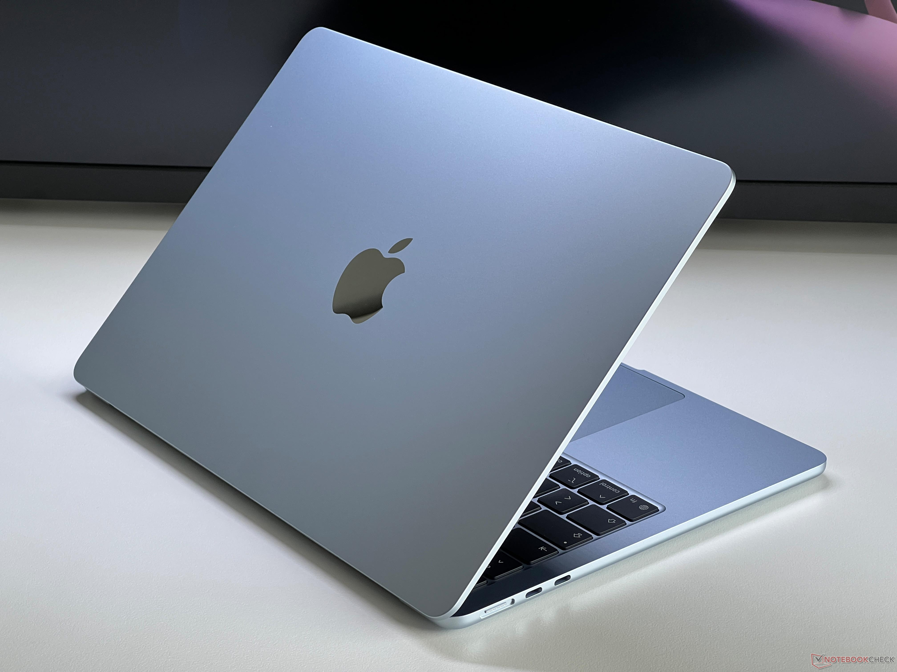
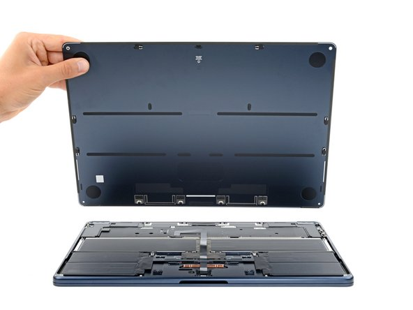
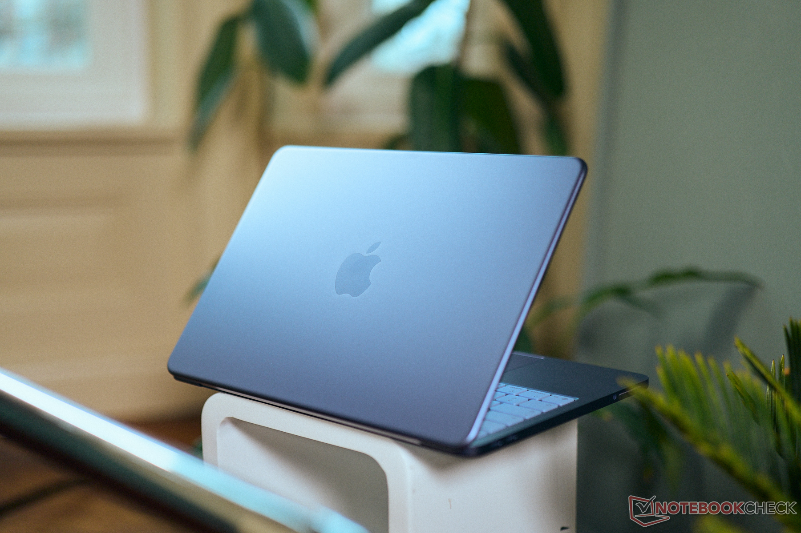
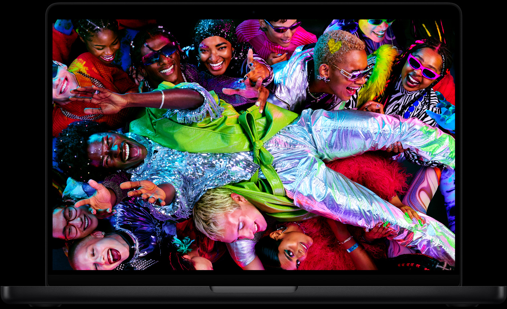
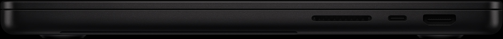

是，更适合。但机制跟多数人想的不一样：**AI 时代没有让 MacBook Air 变强，它做的是把 Air 打不过 MacBook Pro 的那些场景，一个个搬走了。** <!-- 判断句：结论是 Air 更适合普通人，机制是 Air 的短板场景被 AI 搬走而非 Air 变强 -->

「许多工作流都是借助 agent 完成」「剪视频也是 AI 帮助做大部分」——这个观察是对的。2026 年，重计算的环节确实在从本地搬走：渲染交给云端，批处理交给 agent，连剪片子的粗剪、字幕、抠像都有 AI 代劳。

顺着这个正确的前提，很容易滑向一个结论：既然性能用不上了，那就随便买台便宜的。

不是。2026 年买 MacBook，钱该花在哪跟三年前不一样了。

## AI 搬走了什么，留下了什么

一台电脑的性能开销，粗分两类。

一类是「坐定干活」的重负载：剪 4K 时间线、跑批量导出、编译大项目、本地跑模型。这类活吃持续性能。Air 没有风扇，时间一长就降频，这是 Air 的硬伤。

另一类是「随身携带」的轻负载：文档、网页、会议、沟通，外加把任务派给 agent 然后等结果。这类活吃续航、吃安静、吃随手掏出来就能用的响应速度。

AI 和 agent 干的事，本质上是把前一类负载刷掉了一半。发抖音的口播短视频，AI 自动剪辑加字幕就能出片；日常报表，agent 跑完直接发进邮箱。<!-- 判断句：普通人工作流里重负载的占比在下降，且下降的部分恰好是 Air 的短板场景 -->这些活在 2024 年还需要一台性能本，在 2026 年只需要一个浏览器。

而留下来的负载，恰好全是 Air 的主场。

Air 13 只有 1.23 公斤。官方标称 18 小时续航，Notebookcheck 实测 WiFi 上网 16 小时往上——这是 150 尼特亮度下跑出来的。如果你只是挂着 agent 等结果、顺手处理文档，撑一整天不找插座是现实的。

_图源：Notebookcheck 评测实拍_

更关键的是安静。Air 从 M1 起就没有风扇，M5 代依然如此——没有风扇可转，就永远不会有风扇声。<!-- 判断句：无风扇在 agent 时代从性能妥协变成体验优点 -->2024 年这叫「性能妥协」，2026 年这叫「agent 挂着跑也不吵」。

这个体验的价值，参数表上一行都没写：图书馆、会议室、床边的深夜，机器在腿上安静地干活，没有一处需要你去容忍它。

_图源：iFixit 维修指南实拍 · MacBook Air 15 英寸 2026 款拆机，无风扇设计_

## 新的必答题：内存

2026 年买 MacBook，最贵的错误不是买错机型，是买错内存。<!-- 判断句：AI 时代选购的第一优先级从机型变成内存 -->

原因藏在 agent 工作流的真实开销里。

agent 客户端本身不怎么吃性能——真正算活的要么是云端模型，要么是你明确让它在本地跑的东西。但内存的逻辑变了：过去内存服务的是「你开的软件」，现在内存还要服务「你养的 agent」。

本地跑一个 7B、8B 量级的小模型（B 是十亿，7B 就是 70 亿参数，现在 agent 工具链里常见的那种），压缩到 4-bit 之后——把参数精度从 16 位压到 4 位，模型文件体积约为原来的四分之一——权重就要吃掉 4.5 到 5GB。

加上上下文缓存和运行时，16GB 内存才刚够把模型和日常软件同时摆下。<!-- 判断句：7-8B 本地模型占 4.5-5GB，16GB 仅够共存 -->

想再往上，30B 级别的 MoE 模型（总参数很大、但每次只激活一小部分的那种架构，30B 约 300 亿参数）权重约 18GB，再加 8K 上下文，整体需求冲到 20 到 22GB。<!-- 判断句：30B 级 MoE 权重+上下文约 20-22GB，16GB 装不下 -->

16GB 在这个需求面前连门都进不去，没有「慢一点」这个选项——这不是跑得快慢的问题，是装都装不下。<!-- 判断句：16GB 跑不了 30B MoE -->

而且这只是门票钱：24GB 刚够把模型摆下，32GB 才轮得到日常软件从容铺开。至于跑起来舒不舒服，是门票之外的事——编码这类场景对响应速度的要求，远比对话高。

而 MacBook 的内存是焊死的，买定离手。苹果官网 16GB 升 24GB 加 1500 块——这笔钱相对 Air 和 Pro 的差价不值一提，但它是 AI 时代唯一一笔「买了就锁死未来四年体验」的钱。<!-- 判断句：内存升级是整机生命周期里最值的一笔花费 -->

反例是 MacBook Neo。作为苹果最便宜的 Mac，它全系只有 8GB 内存，一个本地模型都跑不起来，agent 工作流稍微重点就顶到天花板。<!-- 判断句：Neo 的 8GB 内存在 AI 时代是硬伤，它只是生态门票不是 AI 时代设备 -->

它可以是进苹果生态的门票，但它跟「AI 时代」没什么关系——AI 时代恰好把内存从「够用就行」改成「多多益善」，而 Neo 在这项上没有任何余地。

_图源：Notebookcheck 评测实拍_

所以 Air 的正确打开方式是：13 寸官网 9999 起、15 寸 11999 起（这是 2026 年 6 月全线涨价后的价格），在此基础上内存尽量往 24GB 或 32GB 堆。

京东自营叠国补后，Air 13 这段时间的到手价在 7100 到 7500 之间——10 月中下旬两篇报道分别是[7436 元](https://news.mydrivers.com/1/1157/1157932.htm)和[7181 元](https://news.mydrivers.com/1/1159/1159402.htm)，电商价格一天一变，下单前自己再核一遍。

## MacBook Pro 还剩下什么

说 MacBook Air 更适合普通人，不等于 MacBook Pro 没场景了。Pro 剩下的东西很具体，就四样。

**屏幕。** Pro 是 Liquid 视网膜 XDR 屏，ProMotion 自适应刷新率最高 120Hz，看 HDR 内容峰值 1600 尼特；10 月底刚发售的新款触屏 OLED 版甚至到 2000 尼特。Air 是 500 尼特的 60Hz LCD。

落到每天的使用里就两个差别：坐在窗边能不能看清，滚动长表格拖不拖影。一天盯屏八小时以上的人，好屏幕差的每一点都实打实。<!-- 判断句：屏幕是 Pro 最普适的剩余价值 -->

_图源：苹果官网_

**接口。** Air 两个雷雳口。Pro 三个雷雳口（M5 Pro/Max 及更新款是雷雳 5，M5 基础款是雷雳 4）、一个 HDMI、一个 SD 卡槽。摄影师的 SD 卡、会议室的 HDMI 线，都是「用一次值一次」的东西。

_图源：苹果官网_

**散热。** 无风扇的 Air 在持续重负载下会降频。这是结构决定的：没有风扇，热量只能靠机身慢慢散，芯片温度一高就只能降功耗保平安。Notebookcheck 在 M4 代 Air 15 的评测里确认过这个热节流现象——无风扇机器的物理约束，换到 M5 代也一样。

所以判别线不在参数表里，在你的日程表里：活一干就是一小时起步、中途停不得的（长视频导出、大批量修图、大项目编译），风扇是刚需，这部分 agent 替你扛不了；走走停停的活，Air 永远撞不到这面墙。<!-- 判断句：Air 持续重负载降频是结构问题，本地重活绕不开 Pro -->

**内存上限。** Pro 最高 128GB，Air 封顶 32GB。想本地跑 70B 以上模型的人，这条路只通到 Pro 门口。

四样数完，Pro 的画像很清楚：它服务的不再是「普通人偶尔的重活」，而是「把重活当饭吃的人」。<!-- 判断句：Pro 的受众收窄为专业重负载人群，变少的是伪需求不是真需求 -->这个人群一直存在，只是 AI 把混在里面打酱油的大多数洗出去了。这才是「Pro 场景变少」的真相。

## 一张清单收尾

回到问题本身：MacBook Air 在 AI 时代是否更适合普通人？

是。但按这张清单买：

| 你是谁 | 买哪台 |
|---|---|
| 文档、网页、会议为主，重活交给 agent | Air 13，内存 24GB 起步 |
| 同上，但想要大屏、不天天盯屏 | Air 15，内存 24GB 起步 |
| 天天盯屏 8 小时以上、在意屏幕观感 | Pro 14，预算够就上 |
| 剪 4K、跑编译、批量修图是日常 | Pro，别纠结 |
| 想本地跑 30B 以上模型 | 32GB 起步；Air 封顶 32GB，更大只能 Pro |
| 只要最便宜的 Mac 进生态 | Neo，但接受它跟 AI 时代无缘 |

一句话版：**AI 没有让 Air 变强，它只是把 Air 打不过 Pro 的场景搬走了。agent 时代的新硬通货是内存——2026 年买 MacBook，先选内存，再选机型，Air 从 24GB 起步。**

你现在的日常工作流里，还有几件非本地不可的重活？评论区报一下工种和场景，这张清单可以按大家的实际情况继续修订。

_信源：苹果官网及 Apple Newsroom（M5 MacBook Air 2026-03 发布稿、M5 Pro/Max MacBook Pro 2026-03 发布稿、触屏 OLED MacBook Pro 2026-10 发布报道）、苹果官网 MacBook Air/Pro 规格页与配置器、Notebookcheck MacBook Air 13 M5 续航实测与 MacBook Air 15 M4 热节流评测、Qwen3-30B-A3B 多源内存测算（apxml/CanIRun.ai 等）、快科技/IT之家 2026-06 苹果涨价报道及 10 月国补到手价报道。价格与配置截至 2026-11-18，电商价格实时波动，下单前以页面为准。_

---

更多 MacBook 选购和到手价实算，可以看我的这篇：[2026 苹果返校季教育优惠全攻略：官网 vs 京东国补逐台实算](https://zhuanlan.zhihu.com/p/156150196)
