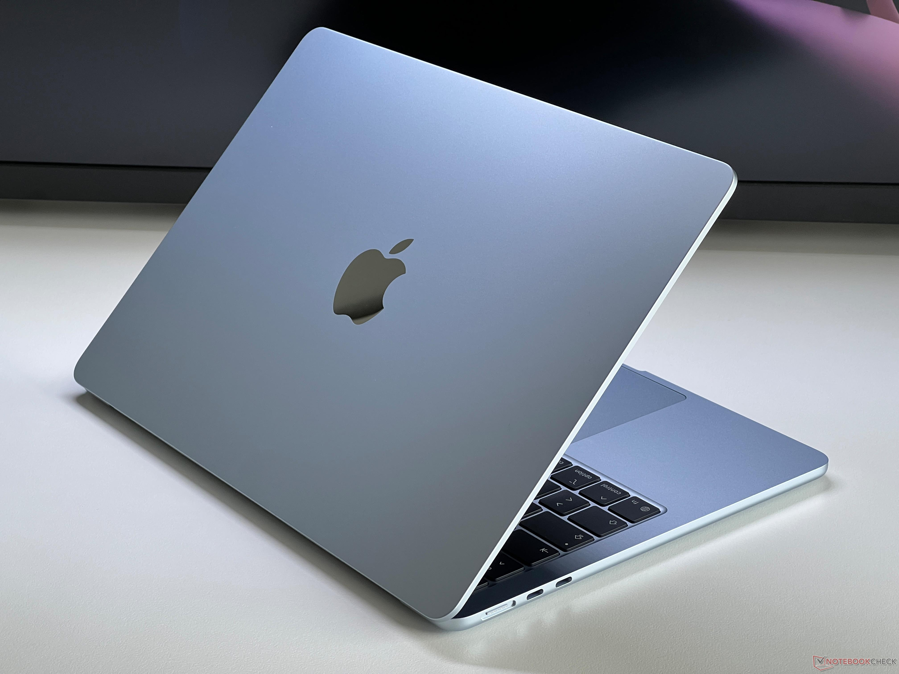
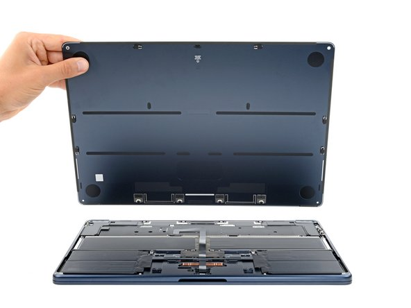
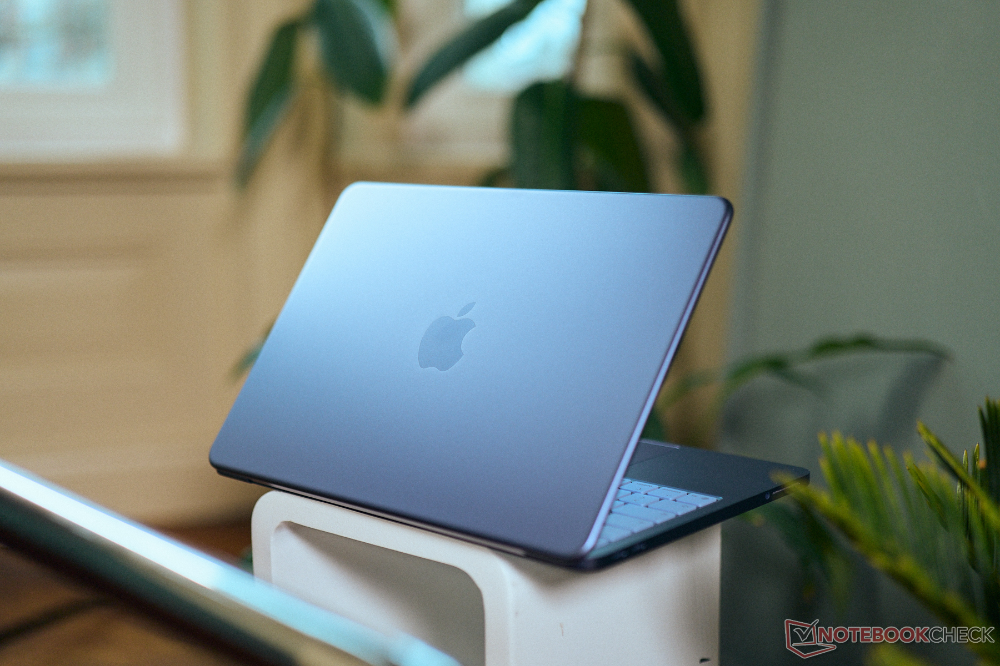
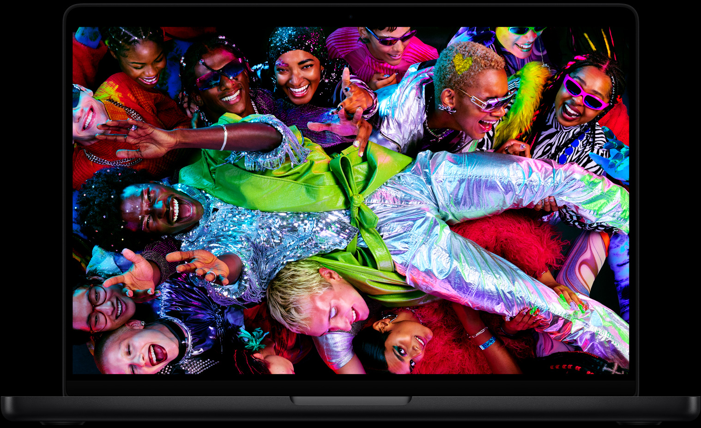
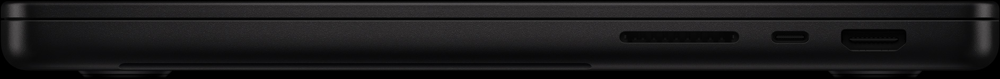

是，更适合。但机制跟多数人想的不一样：**AI 时代没有让 MacBook Air 变强，它做的是把 Air 打不过 MacBook Pro 的那些场景，一个个搬走了。**

这道题底下被反复问到的，其实不是性能，是另外两件事：屏幕看着舒服不舒服，还有 Windows 怎么办。先把这两件说了。

## 先说护眼这件事

很多人对屏幕的体感是真实的：MacBook Air 这块 LCD 屏，在干眼症、频闪敏感的人群里口碑一直很好，不少人反映看别的机器眼睛发酸、看 Air 就没事。这种体感不用被说服，它值得被认真对待。

落到技术上，差别在调光方式。简单说，PWM 就是屏幕靠快速明灭来调亮度，频率低的明灭肉眼看不见、眼睛却累得慌。三个事实摆在这：

- Air 是 LCD 屏，在各类屏幕实测里基本与低频 PWM 无缘；
- 老款 MacBook Pro 的 mini-LED 是约 14880Hz 的高频调光，基本无感；
- 今年 10 月新款 OLED 版 MacBook Pro 发布后被媒体实测出 [240Hz 调光、闪烁幅度 56%](https://news.qq.com/rain/a/20261111A08OZB00)——对频闪敏感的人来说，这不是小事。

医学上的因果我不下结论，每个人的眼睛自己说了算。但选择建议可以给：如果你属于长时间盯屏、又对屏幕敏感的人，MacBook Air 的 LCD 是更稳的选择；纠结的话，去店里把两台机器各看半小时，眼睛会投票。

## AI 搬走了什么，留下了什么

回到问题本身。2026 年，重计算的环节确实在从本地搬走：渲染交给云端，批处理交给 agent，连剪片子的粗剪、字幕、抠像都有 AI 代劳。

一台电脑的性能开销粗分两类：一类是「坐定干活」的重负载，剪 4K 时间线、跑批量导出、大项目编译——这类活吃持续性能，Air 没有风扇，时间一长就降频，这是它的硬伤。另一类是「随身携带」的轻负载：文档、网页、会议、沟通，外加把任务派给 agent 然后等结果——这类活吃续航、吃安静、吃随手掏出来的响应速度。

AI 和 agent 干的事，本质上是把前一类负载刷掉了一半。发抖音的口播短视频，AI 自动剪辑加字幕就能出片；日常报表，agent 跑完直接发进邮箱。这些活在 2024 年还需要一台性能本，在 2026 年只需要一个浏览器。

而留下来的负载，恰好全是 Air 的主场。

Air 13 只有 1.23 公斤。官方标称 18 小时续航，Notebookcheck 实测 WiFi 上网 16 小时往上。如果你只是挂着 agent 等结果、顺手处理文档，撑一整天不找插座是现实的。

_图源：Notebookcheck 评测实拍_

更关键的是安静。Air 从 M1 起就没有风扇，M5 代依然如此——没有风扇可转，就永远不会有风扇声。2024 年这叫「性能妥协」，2026 年这叫「agent 挂着跑也不吵」。图书馆、会议室、床边的深夜，机器在腿上安静地干活，没有一处需要你去容忍它。

_图源：iFixit 维修指南实拍 · MacBook Air 15 英寸 2026 款拆机，无风扇设计_

顺带说一句耐用：无风扇不光是安静，还少了一个活动部件——不进灰、不磨损，整机的故障点是实打实少一些。很多人一台 Air 用四五年，靠的就是这个结构上的简单。

## 新的必答题：内存，但首先是为了 Windows

2026 年买 MacBook，最贵的错误是买错内存。而内存的头号用途，对多数人来说不是跑 AI，是装虚拟机。

很多人买 Mac 的第一件事，是装个 PD 虚拟机把 Windows 请回来——网银、公司 OA、某些只有 Windows 版的行业软件，绕不开。虚拟机的内存是从宿主机器划走的：分给 Windows 多少，Mac 这边就实打实少多少。

用常见的分法算这笔账：

- 16GB 的机器，根本分不出 19GB 给 Windows——这笔钱不存在的；
- 24GB 分 19GB 给 Windows，Mac 宿主只剩 5GB，系统加浏览器就见了底；
- 32GB 分 27GB，宿主留 5GB 运行，两边才算都能转。

所以结论跟不少人想的一样：24GB 是底线，32GB 才从容。这不是性能焦虑，是两边系统同时开张的门票钱。

而 MacBook 的内存是焊死的，买定离手。苹果官网 16GB 升 24GB 加 1500 块——这笔钱相对 Air 和 Pro 的差价不值一提，但它是唯一一笔「买了就锁死未来四年体验」的钱。

反例是 MacBook Neo。作为苹果最便宜的 Mac，它全系只有 8GB 内存——macOS 加浏览器开几个标签页就见了底，虚拟机更是想都别想。它可以是进苹果生态的门票，但「Windows 随时能开」这件事，它给不了。

_图源：Notebookcheck 评测实拍_

此外还有一类新负载：本地模型。agent 工具链里常带 7B、8B 量级的小模型（B 是十亿参数），4-bit 压缩后权重约 4.5 到 5GB；30B 级的大模型连上下文约 20 到 22GB。16GB 面对这些，装载和体验都会很勉强。不玩本地模型的人忽略这段——24GB 起步依然成立。

所以 Air 的正确打开方式是：13 寸官网 9999 起、15 寸 11999 起（这是 2026 年 6 月全线涨价后的价格），在此基础上内存尽量往 24GB 或 32GB 堆。

京东自营叠国补后，Air 13 这段时间的到手价在 7100 到 7500 之间——10 月中下旬两篇报道分别是[7436 元](https://news.mydrivers.com/1/1157/1157932.htm)和[7181 元](https://news.mydrivers.com/1/1159/1159402.htm)，电商价格一天一变，下单前自己再核一遍。

## MacBook Pro 还剩下什么

说 Air 更适合普通人，不等于 MacBook Pro 没场景了。Pro 剩下的东西很具体，就四样。

**屏幕。** 论纸面参数，Pro 是 Liquid 视网膜 XDR 屏，ProMotion 自适应刷新率最高 120Hz，看 HDR 内容峰值 1600 尼特；10 月底的新款 OLED 版峰值甚至到 2000 尼特，纸面几乎挑不出毛病。但对前面说的频闪敏感人群，新 OLED 的 240Hz 调光反而是减分项——屏幕是 Pro 的优势，可优势不落在每个人头上。

_图源：苹果官网_

**接口。** Air 两个雷雳口。Pro 三个雷雳口（M5 Pro/Max 及更新款是雷雳 5，M5 基础款是雷雳 4）、一个 HDMI、一个 SD 卡槽。摄影师的 SD 卡、会议室的 HDMI 线，都是「用一次值一次」的东西。

_图源：苹果官网_

**散热。** 无风扇的 Air 在持续重负载下会降频。这是结构决定的：没有风扇，热量只能靠机身慢慢散，芯片温度一高就只能降功耗保平安。所以判别线不在参数表里，在你的日程表里：活一干就是一小时起步、中途停不得的（长视频导出、大批量修图、大项目编译），风扇是刚需；走走停停的活，Air 永远撞不到这面墙。

**内存上限。** Pro 最高 128GB，Air 封顶 32GB。需要虚拟机里再开大软件、或本地跑超大模型的人，这条路只通到 Pro 门口。

四样数完，Pro 的画像很清楚：它服务的不再是「普通人偶尔的重活」，而是「把重活当饭吃的人」。这个人群一直存在，只是 AI 把混在里面打酱油的大多数洗出去了。这才是「Pro 场景变少」的真相。

## 一张清单收尾

回到问题本身：MacBook Air 在 AI 时代是否更适合普通人？

是。但按这张清单买：

| 你是谁 | 买哪台 |
|---|---|
| 文档、网页、会议为主，重活交给 agent | Air 13，内存 24GB 起步 |
| 同上，但想要大屏、不天天盯屏 | Air 15，内存 24GB 起步 |
| 要装 Windows 虚拟机、两边系统常开 | Air，内存直接 32GB |
| 天天盯屏 8 小时以上、眼睛敏感 | Air 的 LCD 优先，先去店里试 |
| 剪 4K、跑编译、批量修图是日常 | Pro，别纠结 |
| 只要最便宜的 Mac 进生态 | Neo，但接受它开不了虚拟机 |

**2026 年买 MacBook 的顺序：多数人是先选内存，再选机型——24GB 起步，最好 32GB。对屏幕敏感的人，这个顺序倒过来：先选屏幕，再选机型。**

你买笔记本最看重什么——屏幕看着舒服，还是续航和轻便？评论区报一下，这张清单可以按大家的实际情况继续修订。

_主要信源：苹果官网及 Newsroom 规格页（截至 2026-11-18）、Notebookcheck MacBook Air 13 M5 评测与拆机指南、新款 OLED MacBook Pro 调光实测的媒体报道（腾讯网/搜狐，2026-11）。_

---

更多 MacBook 选购和到手价实算，可以看我的这篇：[2026 苹果返校季教育优惠全攻略：官网 vs 京东国补逐台实算](https://zhuanlan.zhihu.com/p/156150196)
